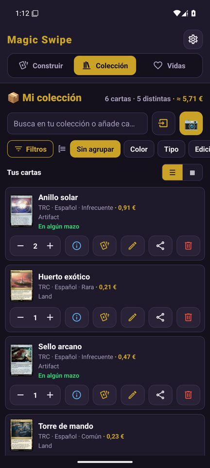
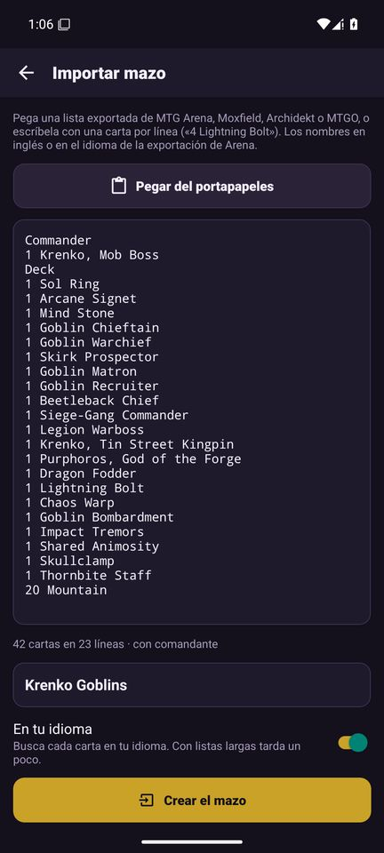
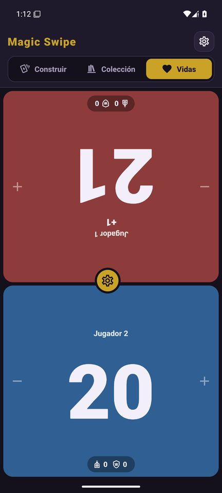

<p align="center">
  
</p>

<h1 align="center">Magic Swipe</h1>

<p align="center">
  <b>Construye mazos de Magic: The Gathering como si tuvieras un puñado de cartas en la mano.</b><br />
  Ve pasándolas una a una: la que te gusta va al mazo, la que no, fuera.
</p>

<p align="center">
  
  
  
  
  
  
</p>

<p align="center">
  <a href="https://github.com/cosmona/magicandroid/releases/latest"><b>📲 Descargar el APK</b></a> ·
  <a href="docs/MANUAL.md"><b>📖 Manual de usuario</b></a> ·
  <a href="docs/ARQUITECTURA.md"><b>📐 Arquitectura</b></a>
</p>

---

# ✨ Características

La app tiene tres pestañas: **Construir**, **Colección** y **Vidas**. Todo está en español y se guarda en el móvil,
sin cuentas.

## 🃏 Construir

<p align="center">
  
  
  
  
</p>

**Las cartas en la mano**
- Las cartas llegan de [Scryfall](https://scryfall.com) una a una: **derecha** al mazo, **izquierda** fuera, flechas
  ‹ › para pasar sin decidir.
- **Historial** de las cartas vistas, para volver a cualquiera.
- **Buscador completo:** nombre (español o inglés), texto de reglas, colores, tipos, coste, rareza, habilidades,
  formato, edición, solo cartas de MTG Arena y orden.
- En cada carta: **idioma**, **arte alternativo**, girar las de dos caras y **La tengo** (sumar o restar en tu
  colección, o ir a verla).

**Tus mazos**
- Varios mazos con formato y portada; crea uno nuevo o **impórtalo** (Arena, también en español, Moxfield,
  Archidekt, MTGO), incluidos drafts con su banquillo.
- Vistas **lista**, **galería** y **grande**, **agrupadas** por tipo, coste, color o rareza, con grupos plegables.
- **Validación por formato** (Commander, Brawl, Estándar, Modern, Limitado… [ver tabla](#-formatos)): nada impide
  añadir, pero marca los errores.
- **Banquillo** en cada mazo: pasa cartas con un botón o **arrastrándolas**.
- Cada carta: copias, 👑 comandante, ficha, **cambiar arte, idioma o portada**, compartir, quitar (con deshacer) y
  cuántas tienes en tu colección.
- **Te faltan N** de tu colección: lista para comprarlas en **Cardmarket** con su precio o, en Arena, los
  **comodines** que necesitas.
- **Compartir** como imagen (WhatsApp, redes), como texto o **para importar en MTG Arena**.
- **Fichas** que crean las cartas del mazo.

<p align="center">
  
  
  
  
</p>

**Analizar el mazo**
- **Estadísticas:** cartas, tierras y coste medio, **curva de maná** (criaturas y otros hechizos), colores frente a las
  tierras que los dan, tipos y aviso de tierras según el formato.
- **Recomendar maná:** añade las tierras básicas que faltan, repartidas por colores, como en Arena.
- **Mano de prueba:** roba 7, haz mulligan eligiendo las cartas al fondo y roba turno a turno; con la probabilidad de
  una buena mano de tierras.

**Sinergias, combos y recomendaciones**
- **Combos del mazo** ([Commander Spellbook](https://commanderspellbook.com)): los que ya tienes y los que están **a una
  carta**, que puedes añadir con ＋.
- **Recomendadas para tu comandante** ([EDHREC](https://edhrec.com)): las cartas de más sinergia que no llevas, en
  lista, galería o **pasándolas como en Construir**, para añadirlas al momento.
- En la **ficha de cada carta**: cuántos mazos la juegan, sus comandantes y compañeras habituales, sus cartas de más
  sinergia si puede ser comandante y sus combos; todas se pueden abrir en grande y añadir al mazo o a la colección.

**Cada carta, al detalle**
- **Ficha completa (ⓘ):** todo lo que Scryfall sabe de la carta (reglas, legalidad, precios, rankings, aclaraciones
  oficiales…) con la explicación de cada dato.
- Cualquier carta en grande dice si **está en tu mazo**, se puede ver en **otro idioma** y marcar con **La tengo**.

## 📦 Colección

<p align="center">
  
  
  
</p>

- **Dos colecciones separadas:** la de **papel** y la de **MTG Arena**. La que elijas es la que usan todos los
  «La tengo» y el aviso de cartas que te faltan de cada mazo.
- Cada carta es una impresión concreta (edición + idioma), con su **valor** en Cardmarket y el total de la colección.
- Añade cartas **buscándolas**, con el **📷 escáner** (reconoce la carta con la cámara), con **La tengo** desde
  cualquier carta o **importando** una lista.
- **Filtros** (color, tipo, coste, rareza, edición, idioma, precio, en algún mazo, repetidas) y **agrupaciones**
  (color, tipo, edición, rareza, coste, precio).
- Cada carta: copias, ficha, añadir al mazo activo, cambiar arte o idioma, **compartir** su imagen o su enlace de
  Scryfall y quitar (con deshacer).
- **Arena:** marca lo que tienes o importa tus mazos de Arena como tuyos, y cada mazo te dice cuántos comodines
  **míticos, raros, infrecuentes y comunes** te faltan.

## ❤️ Vidas

<p align="center">
  
</p>

- Contador de **2 a 6 jugadores** para dejar el móvil en el centro de la mesa (la fila de enfrente, girada).
- Toques para ±1 y pulsación larga para ±10, con el cambio acumulado a la vista.
- **Veneno** y **daño de comandante** de cada rival (que también resta vidas), con aviso de eliminado.
- **¿Quién empieza?**, dados de 6 y de 20 y moneda.
- Nombres y colores por jugador; la pantalla no se apaga y la partida se guarda sola.

## 🧭 En toda la app

- **Ajustes:** idioma de las cartas, vista del mazo, vibración, pantalla completa y dónde ver precios.
- **Código de colores** igual en todas partes (dorado editar, azul información, verde tu colección, amarillo te falta
  algo, rojo borrar) y un **globo con el nombre** de cada botón al mantener el dedo.

## ✅ Formatos

| Formato | Comprobaciones |
|---|---|
| **Commander · Duel · PreDH · Pauper Commander** | Comandante elegido (o dos con *Partner* / *Friends forever* / *Background*), elegible, 100 cartas exactas, 1 copia por carta, identidad de color y legalidad |
| **Oathbreaker** | Igual, con un planeswalker como líder y 60 cartas |
| **Brawl · Standard Brawl** (Arena) | Como Commander (100 / 60 cartas), con criatura o planeswalker legendario de comandante |
| **Estándar · Pioneer · Modern · Legacy · Vintage · Pauper · Premodern · Penny** | Mínimo 60 cartas, máximo 4 copias contando el banquillo (1 si está restringida en Vintage), banquillo de hasta 15 y legalidad |
| **Historic · Timeless · Alchemy** (Arena) | Como Estándar |
| **Limitado** (draft / sellado) | Mínimo 40 cartas, sin límite de copias |
| **Libre** | Sin comprobaciones |

---

# 🛠️ Parte técnica

## 📲 Instalar

Descarga `MagicSwipe.apk` de la **[última versión](https://github.com/cosmona/magicandroid/releases/latest)**, ábrelo
en el móvil y permite instalar apps de origen desconocido. Para generar uno nuevo:

```bash
npx eas-cli@latest login
npx eas-cli@latest build -p android --profile preview
```

## 🚀 Desarrollo

Necesitas [Node.js](https://nodejs.org) y la app **Expo Go** en el móvil (el escáner solo funciona en el APK).

```bash
git clone https://github.com/cosmona/magicandroid.git
cd magicandroid
npm install
npx expo start --go                  # escanea el QR con Expo Go (misma Wi-Fi)
npx expo start --go --tunnel ngrok   # desde fuera de casa
```

```bash
npx tsc --noEmit        # tipos
npx expo lint           # lint (reglas de React Compiler)
npx expo-doctor         # diagnóstico de dependencias
npx expo export --platform android --output-dir <tmp>   # comprobar que compila
```

> **npm 12:** `npx expo install <paquete>` actualiza `package.json` pero su instalación falla con `EALLOWSCRIPTS`. Ejecuta `npm install` después.

## 🧱 Cómo está hecha

- **Expo SDK 58 + React Native + TypeScript**, con **Expo Router** (las tres pestañas arriba) y hojas inferiores
  arrastrables para filtros, mazo, historial y ajustes.
- **Gesture Handler 3 y Reanimated 4** para pasar cartas, arrastrar al banquillo y las animaciones.
- **expo-sqlite** con migraciones versionadas: mazos, banquillo, colecciones de papel y Arena, y ajustes.
- **Scryfall** para cartas, imágenes, precios, símbolos y aclaraciones; **EDHREC** y **Commander Spellbook** para
  sinergias y combos; **Google ML Kit** en el móvil para leer las cartas con la cámara.

```
src/
├── app/            # pantallas y pestañas (Expo Router)
├── api/            # Scryfall, EDHREC y Commander Spellbook
├── collection/     # filtros y agrupaciones de la colección
├── components/     # cartas, hojas, mazo, colección, ficha, sinergias, vidas, ajustes
├── context/        # estado global (mazo activo, filtros, ajustes)
├── db/             # SQLite: esquema, migraciones y consultas
├── deck/           # estadísticas, agrupaciones, Arena, importar listas
├── hooks/          # cola de cartas, precios y datos vivos
├── life/           # contador de vidas
├── scan/           # reconocimiento de cartas por OCR
└── validation.ts   # reglas de cada formato
```

📐 Explicación completa en **[docs/ARQUITECTURA.md](docs/ARQUITECTURA.md)** · ideas pendientes en
[docs/IDEAS.md](docs/IDEAS.md) · notas para desarrollar con IA en [`CLAUDE.md`](CLAUDE.md).

## 🙏 Créditos

- Datos e imágenes de cartas: **[Scryfall](https://scryfall.com)**. Sinergias: **[EDHREC](https://edhrec.com)**.
  Combos: **[Commander Spellbook](https://commanderspellbook.com)**.
- Iconos de maná, rareza, formatos y tipos: del proyecto web original (*frontmagic*), del que esta app es la versión
  Android.

<sub>Magic Swipe es un proyecto de fans sin relación con Wizards of the Coast. Magic: The Gathering y sus cartas son marcas y propiedad de Wizards of the Coast LLC. Proyecto no afiliado a Scryfall, EDHREC ni Commander Spellbook.</sub>
