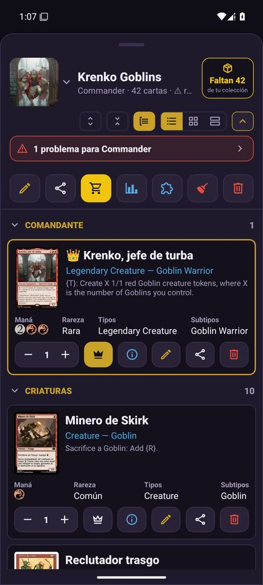
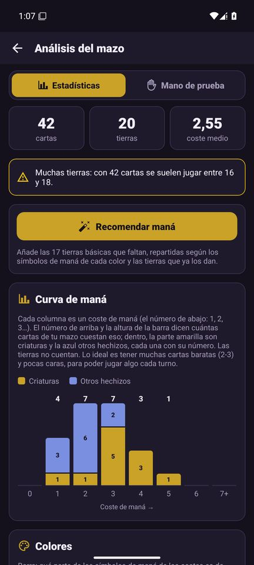
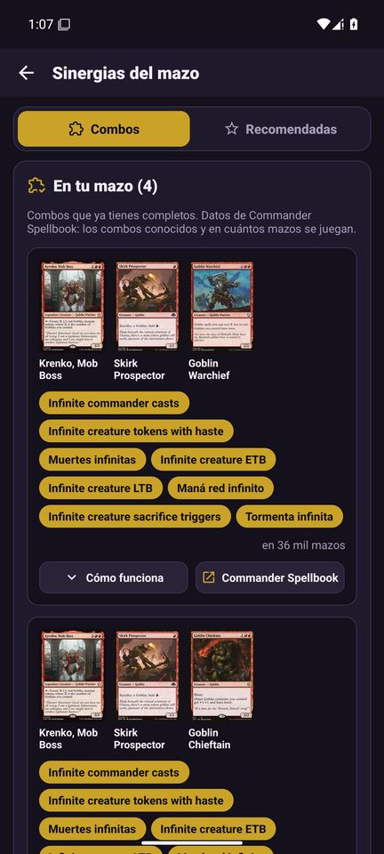
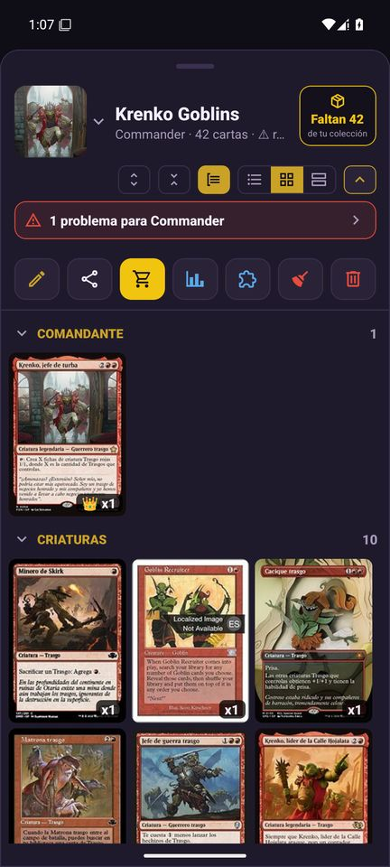
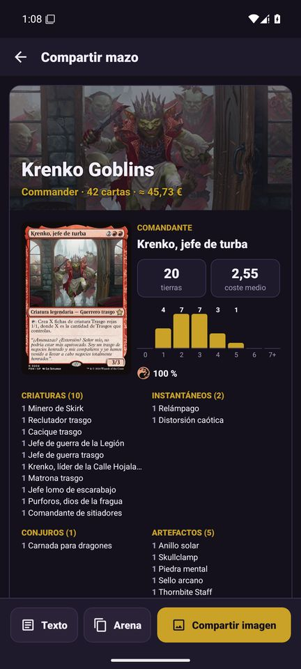
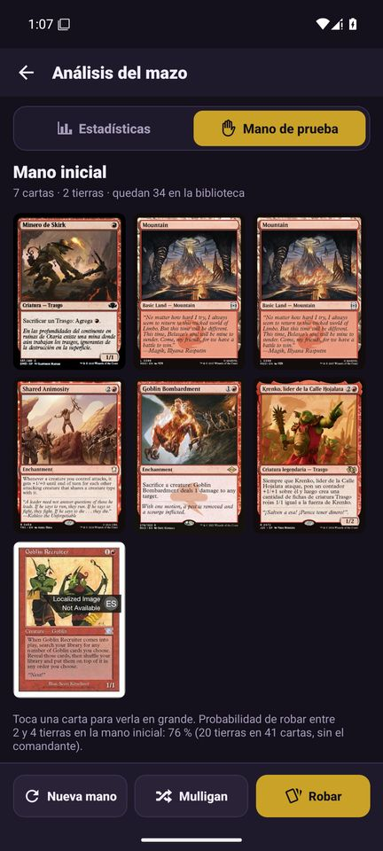
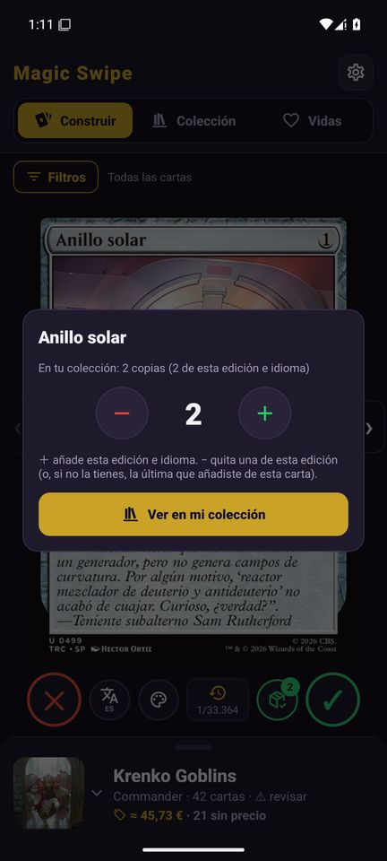

<p align="center">
  
</p>

<h1 align="center">Magic Swipe</h1>

<p align="center">
  <b>Construye mazos de Magic: The Gathering como si tuvieras un puñado de cartas en la mano.</b><br />
  Ve pasándolas una a una: la que te gusta va al mazo, la que no, fuera.
</p>

<p align="center">
  
  
  
  
  
  
</p>

<p align="center">
  
  
  
  
</p>

---

## 🃏 La idea

Abres la app y tienes cartas en la mano. Las miras de una en una, como cuando revisas un montón sobre la mesa:
**deslízala a la derecha** y entra en tu mazo, **a la izquierda** y la apartas. Si solo quieres mirar, pasa con las
flechas ‹ › sin decidir nada. Todo lo demás (filtros, el mazo, tu colección) está a un toque, pero lo central son
siempre las cartas.

## ✨ Qué hace

### Construir

<p>
  
</p>

- 🃏 **Cartas en la mano:** llegan de [Scryfall](https://scryfall.com) una a una. Derecha para el mazo, izquierda
  fuera, flechas ‹ › para pasar sin decidir.
- 🔁 **Fila de botones:** idioma de la carta, arte alternativo, **historial** (vuelve a cualquier carta vista) y
  **La tengo**, para sumar o restar copias en tu colección.
- 🔍 **Buscador completo:** nombre en español o inglés, texto de reglas, colores, tipos, coste, rareza, habilidades,
  formato, edición, «solo cartas de MTG Arena» y orden.
- 🌐 **En tu idioma:** las cartas salen en español si existen, y cualquier carta en grande se puede ver en otro idioma.

<br clear="right" />

### El mazo

<p align="center">
  
  
  
</p>

- 📚 **Varios mazos** con formato y portada, en vista **lista**, **galería** o **grande**, **agrupados** por tipo,
  coste, color o rareza, con grupos plegables.
- ✅ **Validación por formato:** nada impide añadir cartas, pero el mazo marca los errores (tamaño, copias, legalidad,
  comandante 👑 e identidad de color).
- 🪑 **Banquillo** en cada mazo: pasa cartas con un botón o **arrastrándolas**.
- 📦 **Tu colección en cada carta:** «En tu colección: 2», «Te falta 1», con − y ＋, y el aviso «Faltan N» arriba.
- ✏️ **Arte, idioma y portada** de cada carta; 💶 **precios** de Cardmarket y lista de lo que te falta para comprarlo.
- 🖼️ **Compartir** el mazo como imagen (WhatsApp, redes), como texto o **para MTG Arena**.
- 📥 **Importar** listas de Arena (también en español), Moxfield, Archidekt o MTGO, con banquillo y drafts.
- 🎨 **Código de colores** igual en toda la app, y un globo con el nombre de cada botón al mantener el dedo.

### Analizar

<p align="center">
  
  
  
  
</p>

- 📊 **Estadísticas:** curva de maná (criaturas y otros hechizos), colores frente a tierras que los dan, tipos y aviso
  de tierras. **Recomendar maná** añade las básicas que faltan, repartidas por colores, como en Arena.
- ✋ **Mano de prueba:** roba 7, haz mulligan (con las cartas al fondo) y roba turno a turno.
- 🧩 **Sinergias y combos:** cómo se juega cada carta en Commander y sus cartas afines
  ([EDHREC](https://edhrec.com)), los combos que tu mazo tiene o está a una carta de tener
  ([Commander Spellbook](https://commanderspellbook.com)) y recomendaciones para tu comandante, también pasándolas
  como en Construir.
- ⓘ **Ficha completa:** todo lo que Scryfall sabe de una carta, con la explicación de cada dato.

### Colección y más

<p align="center">
  
  
  
</p>

- 📦 **Colección de papel** por edición e idioma: añade buscando, con **📷 el escáner** (reconoce la carta con la
  cámara) o con **La tengo**. Filtros y agrupaciones.
- 🎮 **Colección de MTG Arena**, separada: marca lo que tienes o importa tus mazos de Arena, y cada mazo te dice
  cuántos **comodines** de cada rareza necesitas. Formatos de Arena (Historic, Timeless, Alchemy, Brawl).
- ❤️ **Contador de vidas** de 2 a 6 jugadores, con veneno, daño de comandante, quién empieza y dados.
- 🪙 **Fichas** que crean las cartas del mazo y ⚙ **ajustes** (idioma, vista, vibración, dónde ver precios).

👉 Todo explicado paso a paso, con capturas, en el **[manual de usuario](docs/MANUAL.md)**.

## ✅ Reglas que se comprueban

| Formato | Comprobaciones |
|---|---|
| **Commander · Duel · PreDH · Pauper Commander** | Comandante elegido (o dos con *Partner* / *Friends forever* / *Background*), elegible, 100 cartas exactas, 1 copia por carta, identidad de color y legalidad |
| **Oathbreaker** | Igual, con un planeswalker como líder y 60 cartas |
| **Brawl · Standard Brawl** (Arena) | Como Commander (100 / 60 cartas), con criatura o planeswalker legendario de comandante |
| **Estándar · Pioneer · Modern · Legacy · Vintage · Pauper · Premodern · Penny** | Mínimo 60 cartas, máximo 4 copias contando el banquillo (1 si está restringida en Vintage), banquillo de hasta 15 y legalidad |
| **Historic · Timeless · Alchemy** (Arena) | Como Estándar |
| **Limitado** (draft / sellado) | Mínimo 40 cartas, sin límite de copias |
| **Libre** | Sin comprobaciones |

Las tierras básicas y las cartas con *"any number of cards named"* o *"up to N cards named"* respetan sus propias reglas.

## 📲 Instalarla

Descarga `MagicSwipe.apk` de la **[última versión](https://github.com/cosmona/magicandroid/releases/latest)**,
ábrelo en el móvil y permite instalar apps de origen desconocido.

Para generar uno nuevo:

```bash
npx eas-cli@latest login
npx eas-cli@latest build -p android --profile preview
```

## 🚀 Desarrollo

Necesitas [Node.js](https://nodejs.org) y la app **Expo Go** en el móvil (el escáner solo funciona en el APK).

```bash
git clone https://github.com/cosmona/magicandroid.git
cd magicandroid
npm install
npx expo start --go                  # escanea el QR con Expo Go (misma Wi-Fi)
npx expo start --go --tunnel ngrok   # desde fuera de casa
```

```bash
npx tsc --noEmit        # tipos
npx expo lint           # lint (reglas de React Compiler)
npx expo-doctor         # diagnóstico de dependencias
npx expo export --platform android --output-dir <tmp>   # comprobar que compila
```

> **npm 12:** `npx expo install <paquete>` actualiza `package.json` pero su instalación falla con `EALLOWSCRIPTS`. Ejecuta `npm install` después.

## 🧱 Cómo está hecha

- **Expo Router** con tres pestañas arriba: **Construir** (las cartas en la mano, donde se abre la app),
  **Colección** y **Vidas**. Filtros, mazo, historial y ajustes se abren en hojas inferiores arrastrables.
- **Gestos y animación** con Gesture Handler 3 y Reanimated 4.
- **expo-sqlite** con migraciones versionadas (mazos, banquillo, colecciones de papel y Arena, ajustes). Sin cuentas
  ni servidor: todo se guarda en el móvil.
- **Scryfall** para cartas, imágenes, precios, símbolos y aclaraciones; **EDHREC** y **Commander Spellbook** para
  sinergias y combos.
- **Google ML Kit** en el móvil para leer las cartas con la cámara.

```
src/
├── app/            # pantallas y pestañas (Expo Router)
├── api/            # Scryfall, EDHREC y Commander Spellbook
├── collection/     # filtros y agrupaciones de la colección
├── components/     # cartas, hojas, mazo, colección, ficha, sinergias, vidas, ajustes
├── context/        # estado global (mazo activo, filtros, ajustes)
├── db/             # SQLite: esquema, migraciones y consultas
├── deck/           # estadísticas, agrupaciones, Arena, importar listas
├── hooks/          # cola de cartas, precios y datos vivos
├── life/           # contador de vidas
├── scan/           # reconocimiento de cartas por OCR
└── validation.ts   # reglas de cada formato
```

📐 La explicación completa está en **[docs/ARQUITECTURA.md](docs/ARQUITECTURA.md)**; las ideas pendientes, en
[docs/IDEAS.md](docs/IDEAS.md); las notas para desarrollar con IA, en [`CLAUDE.md`](CLAUDE.md).

## 🙏 Créditos

- Datos e imágenes de cartas: **[Scryfall](https://scryfall.com)**. Sinergias: **[EDHREC](https://edhrec.com)**.
  Combos: **[Commander Spellbook](https://commanderspellbook.com)**.
- Iconos de maná, rareza, formatos y tipos: del proyecto web original (*frontmagic*), del que esta app es la versión
  Android.

<sub>Magic Swipe es un proyecto de fans sin relación con Wizards of the Coast. Magic: The Gathering y sus cartas son marcas y propiedad de Wizards of the Coast LLC. Proyecto no afiliado a Scryfall, EDHREC ni Commander Spellbook.</sub>
