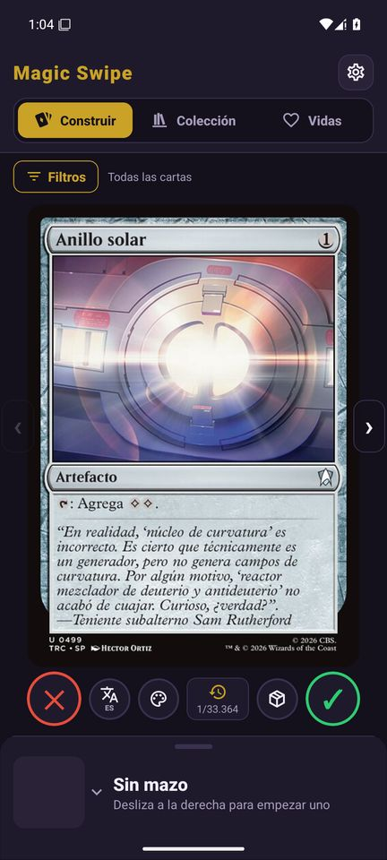
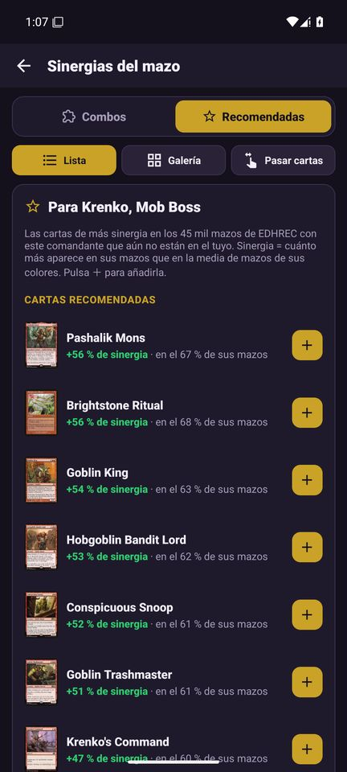

<div align="center">


# Magic Swipe

**El constructor de mazos de Magic: The Gathering que se usa como un puñado de cartas en la mano.**

Pasa las cartas una a una: la que te gusta va al mazo, la que no, fuera.<br />
Mazos, colección de papel y de MTG Arena, sinergias, estadísticas y contador de vidas, todo en el móvil.

<br />


<br /><br />

<a href="https://github.com/cosmona/magicandroid/releases/latest"></a>
&nbsp;
<a href="docs/MANUAL.md"></a>

<br /><br />







</div>

<br />

## Contenido

- [Por qué Magic Swipe](#por-qué-magic-swipe)
- [Funcionalidades](#funcionalidades)
  - [Construir](#construir)
  - [Colección](#colección)
  - [Vidas](#vidas)
- [Formatos compatibles](#formatos-compatibles)
- [Privacidad](#privacidad)
- [Instalación](#instalación)
- [Información técnica](#información-técnica)
- [Créditos y aviso legal](#créditos-y-aviso-legal)

<br />

## Por qué Magic Swipe

<table>
  <tr>
    <td width="25%" valign="top">
      <h3>🃏 Las cartas, primero</h3>
      Construir un mazo es mirar cartas. Aquí las tienes en la mano, una a una, y decides con un gesto.
    </td>
    <td width="25%" valign="top">
      <h3>🧠 Te ayuda a decidir</h3>
      Combos, cartas de más sinergia para tu comandante, curva de maná y una mano de prueba antes de jugar.
    </td>
    <td width="25%" valign="top">
      <h3>📦 Sabe lo que tienes</h3>
      Colección de papel y de MTG Arena por separado: cada mazo te dice qué te falta y cuánto cuesta.
    </td>
    <td width="25%" valign="top">
      <h3>🔒 Tuyo y sin cuentas</h3>
      Todo se guarda en tu móvil. Sin registro, sin servidores propios, sin publicidad.
    </td>
  </tr>
</table>

<br />

## Funcionalidades

La app se organiza en tres pestañas: **Construir**, **Colección** y **Vidas**.

### Construir

<table>
  <tr>
    <td width="34%" valign="top"></td>
    <td valign="top">
      <h4>Las cartas en la mano</h4>
      <ul>
        <li>Desliza a la <b>derecha</b> para añadir al mazo y a la <b>izquierda</b> para descartar; flechas para pasar sin decidir.</li>
        <li><b>Buscador completo</b>: nombre en español o inglés, texto de reglas, colores, tipos, coste, rareza, habilidades, formato, edición y solo cartas de MTG Arena.</li>
        <li><b>Historial</b> de todo lo visto para volver a cualquier carta.</li>
        <li>Cada carta en tu <b>idioma</b>, con sus <b>artes alternativos</b> y contadores para añadirla al <b>mazo</b>, a <b>Posibles</b> o a tu <b>colección</b> (La tengo) sin salir del swipe.</li>
      </ul>
    </td>
  </tr>
  <tr>
    <td valign="top"></td>
    <td valign="top">
      <h4>Tus mazos</h4>
      <ul>
        <li>Vistas <b>lista</b>, <b>galería</b>, <b>grande</b> y <b>texto</b> (como la imagen para compartir, con el comandante en grande), <b>agrupadas</b> por tipo, coste, color, rareza, edición o etiqueta.</li>
        <li><b>Etiquetas</b> en los mazos («Para torneo», «Casual»…), las mismas que las de las cartas.</li>
        <li>Etiqueta <b>«nuevo»</b> en las cartas añadidas al mazo (o a la colección) desde la última vez que lo abriste.</li>
        <li><b>Búsquedas guardadas</b>: guarda unos filtros con un nombre y vuelve a buscar con un toque (se sincronizan con el PC).</li>
        <li><b>Validación</b> en tiempo real según el formato: tamaño, copias, legalidad, comandante e identidad de color.</li>
        <li><b>Banquillo</b> y <b>Posibles</b> en cada mazo, con un botón o arrastrando las cartas.</li>
        <li>Arte, idioma y portada de cada carta; comandante; deshacer al quitar, vaciar o borrar.</li>
        <li><b>Importa</b> listas de MTG Arena (también en español), Moxfield, Archidekt y MTGO, incluidos drafts.</li>
        <li><b>Comparte</b> el mazo como imagen, como texto o listo para importar en MTG Arena.</li>
      </ul>
    </td>
  </tr>
  <tr>
    <td valign="top"></td>
    <td valign="top">
      <h4>Análisis del mazo</h4>
      <ul>
        <li><b>Curva de maná</b> (criaturas y otros hechizos), colores frente a las tierras que los producen, tipos y coste medio.</li>
        <li><b>Recomendar maná</b>: añade las tierras básicas que faltan, repartidas por colores.</li>
        <li><b>Mano de prueba</b> con mulligan y robo turno a turno, y la probabilidad de una buena mano de tierras.</li>
      </ul>
    </td>
  </tr>
  <tr>
    <td valign="top"></td>
    <td valign="top">
      <h4>Sinergias, combos y recomendaciones</h4>
      <ul>
        <li><b>Recomendaciones para tu comandante</b> según cientos de miles de mazos de <a href="https://edhrec.com">EDHREC</a>: en lista, en galería o pasándolas una a una, y añadidas con un toque.</li>
        <li><b>Combos</b> de <a href="https://commanderspellbook.com">Commander Spellbook</a>: los que tu mazo ya tiene y los que están <b>a una carta</b>, con la pieza que falta lista para añadir.</li>
        <li>En la ficha de cada carta: con qué comandantes se juega, qué cartas la acompañan y sus combos; toca una carta de la lista y <b>pásalas deslizando ←/→</b> como una mano, igual que en el PC.</li>
      </ul>
    </td>
  </tr>
  <tr>
    <td valign="top"></td>
    <td valign="top">
      <h4>Cada carta, al detalle</h4>
      <ul>
        <li><b>Ficha completa</b> con todo lo que Scryfall sabe de la carta y la explicación de cada dato.</li>
        <li>Al tocar una carta se abre su <b>ficha a pantalla completa</b>, como en el PC: imagen (tócala para verla sola; las de dos caras se giran), idioma, otras artes, Cardmarket y compartir, La tengo / La quiero, «− ＋ al mazo» y «a Posibles», <b>en qué mazos está</b>, su texto con los símbolos, datos y legalidad; ‹ › para pasar a la siguiente. Los botones <b>«al mazo»</b> y <b>«a Posibles»</b> llevan un <b>▾</b> para añadir a otro mazo (pasa a ser el activo si quieres).</li>
        <li><b>Precio</b> en Cardmarket por carta y por mazo, y la lista de lo que te falta para comprarlo de una vez.</li>
      </ul>
    </td>
  </tr>
</table>

### Colección

<table>
  <tr>
    <td width="34%" valign="top"></td>
    <td valign="top">
      <ul>
        <li>Añade cartas buscándolas, con el <b>escáner</b> (reconoce la carta con la cámara), con <b>La tengo</b> desde cualquier pantalla o importando una lista.</li>
        <li><b>Filtros</b> y <b>agrupaciones</b> por color, tipo, subtipo, coste, rareza, edición, idioma, precio, uso en mazos, copias y etiquetas.</li>
        <li><b>Etiquetas</b> tuyas (texto, color e icono) para marcar cartas («Para cambiar», «Prestada»…) y filtrar por ellas.</li>
        <li><b>La tengo</b> y <b>La quiero</b> por versión: cada edición, idioma y arte por separado.</li>
        <li>En cada carta, <b>en qué mazos está</b> y cuántas copias te quedan libres («En Krenko (2) · 1 libre»).</li>
        <li><b>Valor</b> de la colección en Cardmarket.</li>
        <li>Comparte cualquier carta como imagen o con su enlace de Scryfall.</li>
      </ul>
    </td>
  </tr>
</table>

### Vidas

<table>
  <tr>
    <td width="34%" valign="top"></td>
    <td valign="top">
      <ul>
        <li>Contador para <b>2 a 6 jugadores</b>, pensado para dejar el móvil en el centro de la mesa.</li>
        <li><b>Daño de comandante</b> de cada rival con − / ＋ en el propio recuadro, <b>veneno</b> y aviso de jugador eliminado.</li>
        <li><b>Quién hace el daño</b>: con 3 o más jugadores, el lado − del recuadro se parte en un botón por rival con su color.</li>
        <li><b>Controlador de turnos</b> con las fases de Magic: de quién es el turno, ronda, tiempo y cada paso (enderezar, mantenimiento, robar, principal, combate, final, limpieza).</li>
        <li><b>Estadísticas al terminar</b>: ganador, duración, premios (más daño, golpe más fuerte…) y quién hizo daño a quién.</li>
        <li><b>Pantalla a tu gusto</b> (qué se ve en cada recuadro) y <b>efectos</b>: fotos de cada jugador (recibe daño, hace daño, sube vida), destellos, temblor, números al vuelo, latido con pocas vidas, calavera y confeti para el ganador.</li>
        <li><b>¿Quién empieza?</b>, dados de 6 y de 20 y moneda.</li>
        <li>La pantalla no se apaga durante la partida y el marcador se guarda solo.</li>
      </ul>
    </td>
  </tr>
</table>

### Mano (beta)

Con el móvil en un **soporte** mirando tu mano en abanico, la cámara **lee los títulos** de las cartas (reconocimiento de
texto en el propio móvil) y apunta **lo que robas y lo que juegas**, comparando con las cartas del mazo activo. Se activa
en **Ajustes → Mano (beta)** y la primera vez enseña una **guía con dibujos** de cómo colocar la cámara y las cartas.

En toda la app: **temas de apariencia** (10 temas y, si quieres, cada color por separado, en Ajustes → Apariencia), **código de colores** coherente, **ayuda** al mantener pulsado cualquier botón y **ajustes** de idioma,
vistas, etiquetas, vibración y precios. **Sincronizar con Magic Swipe para PC** por la Wi-Fi: escanea el QR del PC, revisa en la pantalla del PC todo lo que es
distinto (mazos, colección, «La quiero» y etiquetas) con la opción sugerida ya marcada, y al aplicar los dos quedan
iguales; antes se guarda una copia que puedes restaurar. También se puede copiar o mover todo de uno a otro. **Posibles** en cada mazo para apartar cartas que te estás pensando y
**♡ La quiero** para apuntar las cartas que quieres conseguir (salen en tu colección).

<br />

## Formatos compatibles

| Formato | Qué se comprueba |
|---|---|
| **Commander · Duel · PreDH · Pauper Commander** | Comandante (o pareja con *Partner*, *Friends forever* o *Background*), 100 cartas, 1 copia por carta, identidad de color y legalidad |
| **Oathbreaker** | Planeswalker como líder, 60 cartas, 1 copia por carta, identidad de color y legalidad |
| **Brawl · Standard Brawl** · MTG Arena | Criatura o planeswalker legendario de comandante, 100 / 60 cartas, 1 copia y legalidad |
| **Estándar · Pioneer · Modern · Legacy · Vintage · Pauper · Premodern · Penny** | Mínimo 60 cartas, hasta 4 copias contando el banquillo (1 si está restringida en Vintage), banquillo de hasta 15 y legalidad |
| **Historic · Timeless · Alchemy** · MTG Arena | Como Estándar, con las cartas de MTG Arena |
| **Limitado** (draft y sellado) | Mínimo 40 cartas, sin límite de copias |
| **Libre** | Sin restricciones |

<br />

## Privacidad

- **Sin cuentas ni registro.** Mazos, colecciones y ajustes se guardan solo en el móvil (SQLite).
- **Sin servidores propios, sin analítica y sin publicidad.**
- La app solo se conecta a servicios públicos de cartas para consultar datos: Scryfall, EDHREC y Commander Spellbook.
  No les envía nada tuyo más allá de las cartas que consulta.
- El escáner reconoce las cartas **en el propio móvil**: las fotos no salen del dispositivo.
- La sincronización con el PC va **directamente por tu red local**, sin pasar por internet.

<br />

## Instalación

1. Descarga `MagicSwipe.apk` de la **[última versión](https://github.com/cosmona/magicandroid/releases/latest)**.
2. Ábrelo en el móvil Android y permite la instalación de apps de origen desconocido.
3. El **[manual de usuario](docs/MANUAL.md)** explica cada pantalla, con capturas.

<br />

## Información técnica

<table>
  <tr><td><b>Plataforma</b></td><td>Android · Expo SDK 58 · React Native · TypeScript</td></tr>
  <tr><td><b>Navegación</b></td><td>Expo Router, pestañas superiores y hojas inferiores arrastrables</td></tr>
  <tr><td><b>Gestos y animación</b></td><td>React Native Gesture Handler 3 · Reanimated 4</td></tr>
  <tr><td><b>Datos locales</b></td><td>expo-sqlite con migraciones versionadas</td></tr>
  <tr><td><b>Fuentes de datos</b></td><td>Scryfall (cartas, imágenes, precios) · EDHREC (sinergias) · Commander Spellbook (combos)</td></tr>
  <tr><td><b>Reconocimiento de cartas</b></td><td>Google ML Kit en el dispositivo</td></tr>
  <tr><td><b>Compilación</b></td><td>EAS Build</td></tr>
</table>

<details>
<summary><b>Desarrollo</b></summary>

<br />

Requisitos: [Node.js](https://nodejs.org) y la app **Expo Go** en el móvil (el escáner solo funciona en el APK).

```bash
git clone https://github.com/cosmona/magicandroid.git
cd magicandroid
npm install
npx expo start --go                  # escanea el QR con Expo Go (misma red Wi-Fi)
npx expo start --go --tunnel ngrok   # fuera de la red local
```

Comprobaciones:

```bash
npx tsc --noEmit        # tipos
npx expo lint           # lint (reglas de React Compiler)
npx expo-doctor         # dependencias
npx expo export --platform android --output-dir <tmp>   # el bundle compila
```

Generar un APK:

```bash
npx eas-cli@latest build -p android --profile preview
```

> **npm 12:** `npx expo install <paquete>` actualiza `package.json` pero su instalación falla con `EALLOWSCRIPTS`; ejecuta `npm install` después.

</details>

<details>
<summary><b>Estructura del código</b></summary>

<br />

```
src/
├── app/            # pantallas y pestañas (Expo Router)
├── api/            # Scryfall, EDHREC y Commander Spellbook
├── collection/     # filtros y agrupaciones de la colección
├── components/     # cartas, hojas, mazo, colección, ficha, sinergias, vidas, ajustes
├── context/        # estado global (mazo activo, filtros, ajustes)
├── db/             # SQLite: esquema, migraciones y consultas
├── deck/           # estadísticas, agrupaciones, Arena, importación de listas
├── hooks/          # cola de cartas, precios y datos en vivo
├── life/           # contador de vidas
├── scan/           # reconocimiento de cartas
└── validation.ts   # reglas de cada formato
```

</details>

**Documentación:** [Manual de usuario](docs/MANUAL.md) · [Arquitectura](docs/ARQUITECTURA.md) ·
[Ideas y hoja de ruta](docs/IDEAS.md) · [Guía para desarrollo con IA](CLAUDE.md)

<br />

## Créditos y aviso legal

- Datos e imágenes de cartas: **[Scryfall](https://scryfall.com)**.
- Sinergias y estadísticas de uso: **[EDHREC](https://edhrec.com)**.
- Combos: **[Commander Spellbook](https://commanderspellbook.com)**.
- Iconos de maná, rareza, formatos y tipos: del proyecto web original *frontmagic*.

<sub>Magic Swipe es un proyecto independiente de fans, sin relación con Wizards of the Coast, Hasbro, Scryfall, EDHREC ni Commander Spellbook. Magic: The Gathering, MTG Arena y todos los nombres, símbolos e imágenes de las cartas son marcas y propiedad de Wizards of the Coast LLC.</sub>
