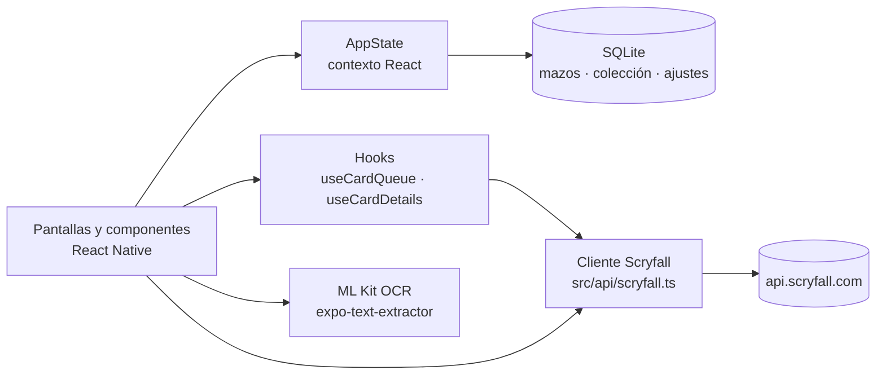
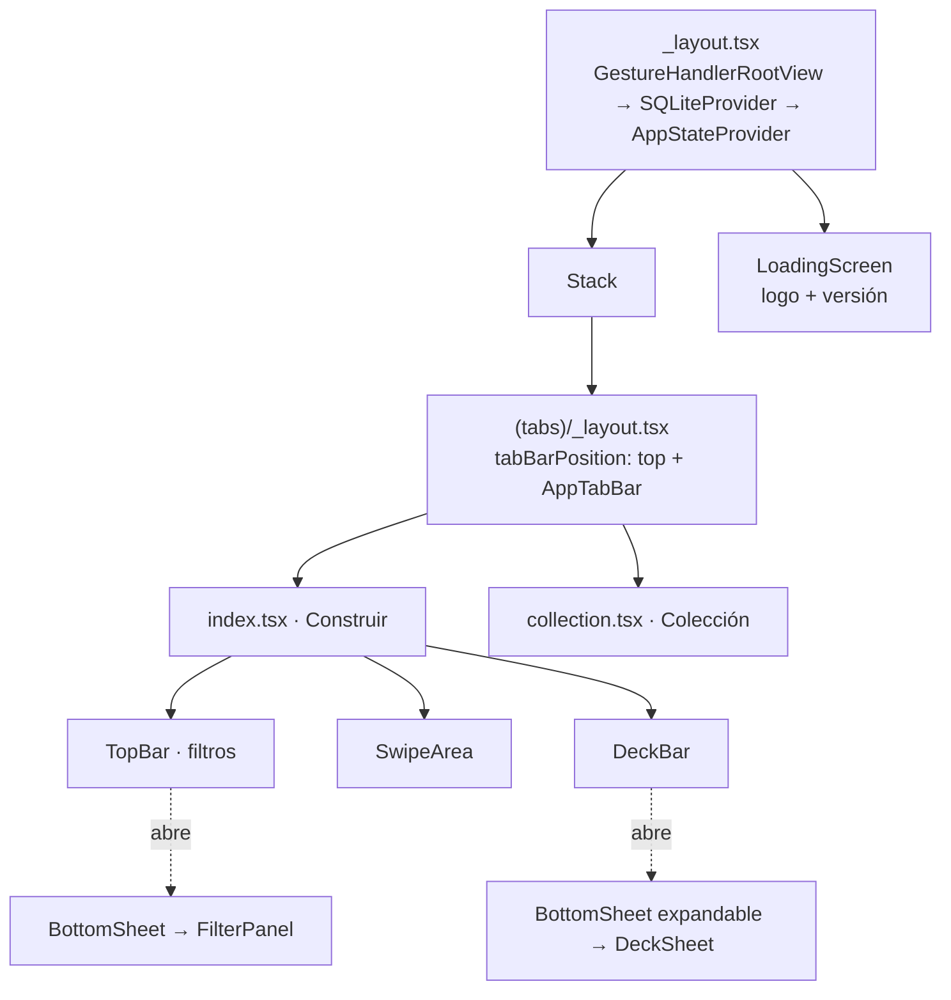
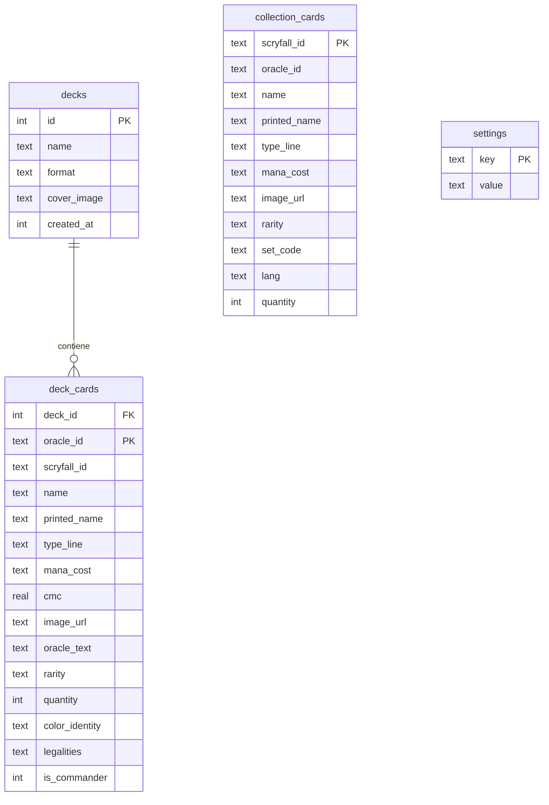
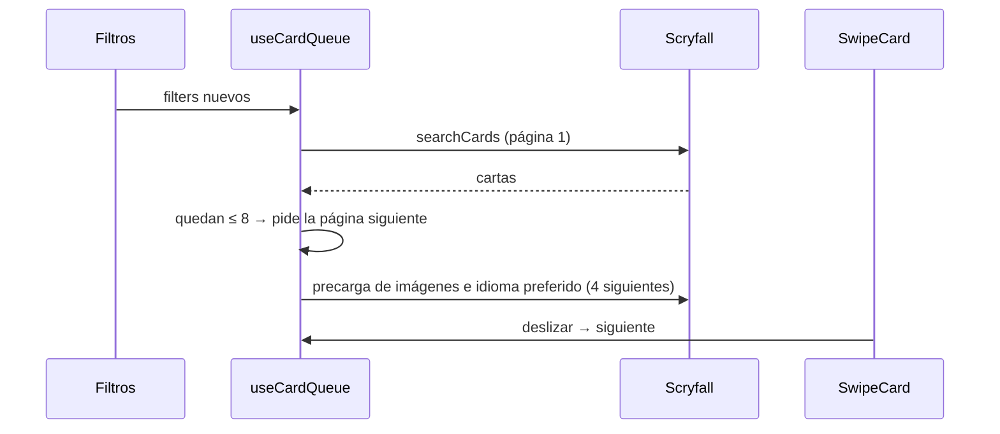
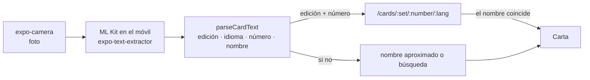

# 🧱 Arquitectura de Magic Swipe

> Documento vivo: explica cómo está hecha la app y por qué. Se actualiza con cada cambio de estructura.
> Para usar la app, ver el [manual de usuario](MANUAL.md).

## Índice

1. [Visión general](#1-visión-general)
2. [Tecnologías](#2-tecnologías)
3. [Estructura de carpetas](#3-estructura-de-carpetas)
4. [Navegación y pantallas](#4-navegación-y-pantallas)
5. [Estado global](#5-estado-global)
6. [Datos: Scryfall](#6-datos-scryfall)
7. [Datos: SQLite](#7-datos-sqlite)
8. [Construir: la cola de cartas y el gesto](#8-construir-la-cola-de-cartas-y-el-gesto)
9. [Hojas inferiores y gestos](#9-hojas-inferiores-y-gestos)
10. [El mazo](#10-el-mazo)
11. [La colección](#11-la-colección)
12. [Validación de formatos](#12-validación-de-formatos)
13. [Escáner de cartas](#13-escáner-de-cartas)
14. [Decisiones de diseño](#14-decisiones-de-diseño)
15. [Compilar y publicar](#15-compilar-y-publicar)

---

## 1. Visión general

App Android sin servidor: todo lo que es del usuario vive en una base de datos **SQLite local**, y todo lo que es de las
cartas viene de la **API pública de Scryfall**. No hay cuentas ni backend.



Es la versión Android del proyecto web *frontmagic* (React) + *apimagic* (Express/MySQL). La web usaba otra API de
cartas y una base de datos en servidor; aquí se cambió a Scryfall y almacenamiento local.

## 2. Tecnologías

| Pieza | Para qué |
|---|---|
| **Expo SDK 58** + React Native 0.88 + React 19 + TypeScript | Base de la app |
| **Expo Router** | Navegación por archivos (`src/app/`) |
| **expo-sqlite** | Base de datos local con migraciones |
| **react-native-gesture-handler 3** (API de hooks) + **Reanimated 4** | Deslizar cartas y hojas en el hilo de UI |
| **expo-image** | Imágenes con caché y precarga |
| **@expo/vector-icons** (Material Community Icons) | Iconos |
| **expo-camera** + **expo-text-extractor** (Google ML Kit) | Escáner de cartas |
| **expo-clipboard**, **expo-haptics**, **expo-navigation-bar** | Copiar listas, vibración, barra de Android |
| **EAS Build** | Compilar el APK en la nube |

El proyecto usa las reglas de lint del **React Compiler**: nada de `setState` síncrono en efectos (se ajusta el estado
durante el render o desde callbacks asíncronos) y los valores compartidos de Reanimated se leen con `.get()/.set()`.

## 3. Estructura de carpetas

```
src/
├── app/                      # Rutas (Expo Router)
│   ├── _layout.tsx           # Raíz: gestos, SQLite, AppState, pantalla de carga
│   └── (tabs)/               # Pestañas: _layout (AppTabBar), index = Construir, collection
├── api/scryfall.ts           # Cliente de Scryfall: búsquedas, idiomas, artes, precios, sets, símbolos…
├── collection/organize.ts    # Filtros y agrupaciones de la colección (funciones puras)
├── components/
│   ├── AppTabBar.tsx         # Cabecera + pestañas arriba + hoja de ajustes
│   ├── BottomSheet.tsx       # Hoja inferior animada + SheetDragArea
│   ├── CardControls.tsx      # Botones compartidos de carta: cantidad, iconos, barra de deshacer
│   ├── SwipeArea / SwipeCard # Las cartas en la mano
│   ├── HistorySheet, LanguagePicker, ArtPicker, ManaCost, TopBar, SettingsSheet…
│   ├── cardInfo/             # Ficha completa de Scryfall (pantalla + diccionario de campos)
│   ├── collection/           # Pantalla de colección, panel de filtros, escáner, botón «La tengo»
│   ├── deck/                 # Barra, hoja, cabecera, selector, Cardmarket, fichas
│   └── filters/FilterPanel   # Filtros de búsqueda de Construir
├── context/AppState.tsx      # Estado global
├── db/database.ts            # Esquema, migraciones y todas las consultas
├── deck/stats.ts             # Estadísticas del mazo y mano de prueba (funciones puras)
├── hooks/                    # useCardQueue (cola de cartas), useCardDetails (precios…)
├── scan/recognizeCard.ts     # OCR → carta de Scryfall
├── icons.ts, theme.ts        # Iconos locales, colores, formatos, utilidades de formato
└── validation.ts             # Reglas de cada formato (función pura)
```

## 4. Navegación y pantallas



- Las **pestañas van arriba** (`tabBarPosition: 'top'`) con una barra propia, `AppTabBar`, que dibuja la cabecera
  «Magic Swipe» + ⚙ y un control segmentado con el `title` y el `tabBarIcon` de cada pantalla. Por eso las pantallas no
  reservan el margen superior; el inferior lo reservan `DeckBar` y la colección.
- **Nueva herramienta** (p. ej. contador de vidas): un archivo en `src/app/(tabs)/` y un `<Tabs.Screen>` en su layout.
- Lo que se abre encima (filtros, mazo, historial, ajustes) son **hojas inferiores**, no pantallas, para que la pila de
  cartas no se desmonte y conserve su posición.
- La **ficha completa** (`cardInfo/CardInfoScreen`) es un `Modal` a pantalla completa, porque se abre desde dentro de la
  hoja del mazo (que ya es un `Modal`) y una ruta normal quedaría debajo.

## 5. Estado global

`src/context/AppState.tsx` reparte:

| Dato | Persistencia |
|---|---|
| Lista de mazos, mazo activo y sus cartas | SQLite (`decks`, `deck_cards`); id activo en `settings` |
| Filtros de búsqueda | `settings` (clave versionada `FILTERS_KEY`) |
| Preferencias (`prefs`): idioma, vibración, vista del mazo, pantalla completa, botones del mazo ocultos y dónde se muestran precios (`pricesDeck`, `pricesDeckCards`, `pricesShopping`, `pricesCollection`, `pricesCardInfo`) | `settings` (`prefs`); campos nuevos van a `DEFAULT_PREFS` |

Reglas:

- Tras **cada escritura** en la base de datos se llama a `refresh(deckId?)`.
- `ensureActiveDeck()` crea «Mazo sin nombre» al primer deslizamiento a la derecha si no hay mazo.
- Un **objeto `filters` nuevo** (identidad distinta) es lo que dispara una búsqueda nueva.

## 6. Datos: Scryfall

Todo pasa por `src/api/scryfall.ts`:

- **`scryfallFetch`**: añade `User-Agent` y `Accept` (Scryfall los exige) y separa las peticiones al menos **100 ms**.
- Un **404 `not_found`** en una búsqueda significa «sin resultados», no error.
- **`Card`**: tipo plano propio; las cartas de dos caras toman imágenes y textos de `card_faces`.
- **Búsqueda** (`buildQuery` + `searchCards`): traduce `Filters` a la sintaxis de Scryfall. Los nombres usan términos
  `name:` sin comillas (las comillas no ignoran tildes) y, si ningún nombre inglés coincide, se repite con `lang:any`
  para que funcionen los nombres en español.
- **Idiomas** (`getCardLanguages`, `getCardInLanguage`) y **artes** (`getCardArts`, `unique=art`), con caché.
- **`cached()`**: memoriza catálogos (habilidades, sets, símbolos) durante la ejecución.
- **Datos vivos** (`getCardDetails` + hook `useCardDetails`): precio en €, enlace de Cardmarket, fuerza/resistencia,
  lealtad, defensa y fichas (`all_parts`), pedidos en lotes de 75 a `/cards/collection` y cacheados en memoria. **No se
  guardan** porque los precios cambian a diario. Scryfall casi no da precio a impresiones no inglesas: se pide la
  inglesa de la misma edición y número.
- **Ficha completa**: `getRawCard` devuelve el objeto de Scryfall tal cual y `getRulings` sus aclaraciones;
  `cardInfo/fields.ts` traduce y explica cada campo (los de imágenes se omiten a propósito, y los desconocidos acaban en
  «Otros datos»).
- **Símbolos de maná**: `getSymbols` (`/symbology`) → SVG que pinta `ManaCost`.

### Sinergias (fuera de Scryfall)

`src/api/synergy.ts` habla con dos webs de la comunidad, con caché en memoria por carta:

- **EDHREC** (no tiene API oficial: se leen los JSON que carga su propia web, `json.edhrec.com/pages/{cards|commanders}/<slug>.json`;
  pueden cambiar sin aviso). `edhrecSlug` convierte el nombre (sin tildes ni apóstrofos; cara frontal primero y nombre
  completo para cartas partidas). `getEdhrecCard` → mazos, porcentaje, sal, comandantes y cartas afines;
  `getEdhrecCommander` → todas sus cartas ordenadas por `synergy` (null si no es comandante: 403/404). Los `id` de
  EDHREC son ids de Scryfall, así que las imágenes salen de `/cards/collection`.
- **Commander Spellbook** (API pública): `getCardCombos` (`/variants/?q=card:"…"`, por popularidad) y `findDeckCombos`
  (`POST /find-my-combos` con el mazo y los comandantes → `included` y `almostIncluded`). Los resultados más comunes se
  traducen; las piezas genéricas (`requires`) van con los requisitos, no con las cartas.

UI: `cardInfo/CardSynergy` (secciones de la ficha), `deck/DeckSynergyScreen` (pantalla del mazo, `Modal` con pestañas
Combos / Recomendadas y ＋ que añade al mazo) y piezas compartidas en `synergy/SynergyParts` (`ComboView`, `EntryRow`,
`useCardImages` por id o por nombre). `cardInfo/Section` es el bloque con título que usan ambas pantallas.

## 7. Datos: SQLite

`src/db/database.ts` contiene el esquema, las migraciones y todas las consultas (sin ORM). Versión actual: **4**.



- **Mazo**: una fila por carta (`oracle_id`, la carta como concepto) con la impresión elegida (`scryfall_id`).
- **Colección**: una fila por **impresión** (edición + idioma). «Cuántas tengo» de una carta suma por `oracle_id`.
- **Migraciones**: `PRAGMA user_version`. Para cambiar el esquema se sube `DATABASE_VERSION` y se añade un paso
  `if (version === N)`; los pasos existentes **no se tocan**.
- `PRAGMA foreign_keys = ON` en cada arranque: borrar un mazo borra sus cartas.
- Filas antiguas sin datos de validación se completan desde Scryfall al abrir su mazo.
- **Deshacer**: `snapshotDeck`/`restoreSnapshot` y `snapshotCollectionCard`/`restoreCollectionRow` copian las filas
  crudas y las reinsertan tal cual (mismo id de mazo).

## 8. Construir: la cola de cartas y el gesto



- **`useCardQueue`**: cola paginada. Cada respuesta va etiquetada con los filtros que la pidieron para ignorar respuestas
  viejas. La posición se reinicia durante el render al cambiar la búsqueda.
- **`SwipeCard`**: gesto con `usePanGesture` (RNGH 3) y animación en el hilo de UI; avisa a React con `scheduleOnRN`.
  Los botones lanzan la misma animación con `swipe(dir)`. Se renderiza con `key={card.id}`.
- **`SwipeArea`**: decisiones por id de carta, historial para **deshacer** (cada entrada guarda su posición y el mazo al
  que fue) y flechas ‹ › para pasar sin decidir.

## 9. Hojas inferiores y gestos

`BottomSheet` se monta sobre un `Modal` de React Native (fiable en Android y Expo Go) y se anima con Reanimated:

- **Arrastrar**: la barra superior y cualquier zona envuelta en **`SheetDragArea`** mueven la hoja con el dedo. Cada
  zona crea su propio gesto (solo vertical, así las listas horizontales de dentro siguen funcionando). Si se arrastra
  desde un botón, el toque del botón se cancela. **Nunca** se envuelve una lista vertical.
- **`expandable`** (la hoja del mazo): tres paradas, oculta / abierta (`heightRatio`) / pantalla completa. Se maqueta a
  tamaño completo y se desplaza hacia abajo, con relleno inferior en la parada «abierta» para que no se corte el
  contenido.
- **Cierre**: si se cierra arrastrando, la propia animación del gesto termina el trabajo (`dragClosing`); el efecto de
  `visible=false` solo anima los cierres por botón o por tocar fuera.

Los gestos propios se limitan al deslizar de cartas, la `DeckBar` y las hojas: versiones anteriores con paneles
animados a mano chocaban con botones y listas.

## 10. El mazo

- **`DeckBar`** (cerrada) y la cabecera de **`DeckSheet`** comparten **`DeckSummary`**: portada, nombre, formato,
  estado y precio (`useCardDetails`, la misma caché).
- **`DeckSheet`**: parte fija arrastrable (resumen, selector de mazos `DeckPicker` desplegable desde la portada, línea
  de colección con selector de vista y botón de ocultar, aviso de validación de una línea, botones) y debajo la lista
  de cartas (lista / galería / grande).
- **`MissingCardsModal`**: cartas que faltan respecto a la colección, con precio, enlace a Cardmarket y lista para
  copiar.
- **`TokensModal`**: fichas que crean las cartas (agrupadas por nombre y tipo).
- **`DeckStatsScreen`** (botón del gráfico, `Modal` a pantalla completa): pestaña *Estadísticas* (resumen, aviso de
  tierras, curva apilada criaturas / otros, símbolos por color frente a tierras que lo dan, tipos; gráficos hechos con
  `View`, sin librería) y pestaña *Mano de prueba* (biblioteca sin comandantes, barajar, mulligan London eligiendo las
  cartas al fondo, robar). Los cálculos están en **`deck/stats.ts`** (puro): `deckStats` (usa `cmc` de Scryfall;
  `landColors` lee «Add {G}», «any color», tipos básicos y básicas que busca), `buildLibrary`, `shuffle` y
  `landOdds` (hipergeométrica). **Recomendar maná** (`LandRecommender`): `recommendLands` calcula las tierras
  objetivo (37 % del tamaño exacto en formatos con comandante; ~40 % y al menos 24 en construido; se añaden aunque el mazo pase del tamaño, y la validación lo avisa) y las
  reparte entre los colores permitidos (identidad del comandante o los que tienen símbolos) por el déficit de fuentes
  (`apportion`, mayor resto). Las básicas se buscan por nombre inglés (`getCardsByNames`) y se pasan al idioma
  preferido; deshacer restaura una `snapshotDeck` previa.

## 11. La colección

- **`CollectionScreen`**: buscador (filtra la colección y busca en Scryfall a la vez), escáner, filtros y agrupación.
- **`collection/organize.ts`** (puro, sin React): `applyFilter` y `groupCards`. El color sale de los símbolos del coste
  y el coste de maná se calcula de la cadena (las tierras cuentan 0). Las secciones llevan copias y valor.
- La lista es una `FlatList` de elementos aplanados: cabeceras de grupo, cartas (lista) o filas de 3 (galería).
- Los botones de cada carta y la barra de deshacer vienen de **`CardControls`**, compartidos con el mazo.

## 12. Validación de formatos

`src/validation.ts` → `validateDeck(format, cards)` es **pura**: devuelve problemas del mazo y por carta. La app nunca
impide añadir; solo informa. Comprueba tamaño, copias por `oracle_id`, legalidad (guardada de Scryfall), comandante
(elegibilidad, parejas) e identidad de color.

## 13. Escáner de cartas



ML Kit es nativo: **no está en Expo Go** (`scanSupported` es `false` y el escáner lo explica). Las coincidencias
aproximadas de Scryfall se verifican palabra a palabra porque a veces adivina mal.

## 14. Decisiones de diseño

- **«Cartas en la mano», nunca «Tinder»**: la pantalla central es la pila de cartas.
- **Sin límites al añadir**: la validación avisa, no bloquea.
- **Local primero**: sin cuentas; lo vivo (precios) se pide y no se guarda.
- **Deshacer en vez de miedo**: confirmación en lo destructivo y barra de deshacer de 6 s.
- **Iconos** de Material Community Icons; emojis solo donde aún no se han cambiado.

## 15. Compilar y publicar

- **Desarrollo con Expo Go**: `npx expo start --go` (con `expo-dev-client` instalado, `npx expo start` a secas apunta a
  una build de desarrollo).
- **Comprobaciones**: `npx tsc --noEmit`, `npx expo lint`, `npx expo-doctor` y
  `npx expo export --platform android --output-dir <tmp>`.
- **APK**: EAS Build, perfil `preview` (`eas.json`). Proyecto `inakipf/magicandroid`, paquete `com.magicswipe.app`.
- **npm 12**: tras `npx expo install <paquete>`, ejecutar `npm install`.
