# 📖 Manual de usuario de Magic Swipe

> Este manual crece con la app: cada vez que algo cambia, se actualiza aquí.
> Las capturas son de un Android con las cartas en español y un mazo de ejemplo.
> Versión de la app: **1.0.0** · Última revisión: noviembre de 2026.

Magic Swipe sirve para construir mazos de *Magic: The Gathering* como si tuvieras un puñado de cartas en la mano: las vas
pasando una a una y decides cuáles se quedan. También lleva la cuenta de las cartas que tienes de verdad (tu colección),
te dice cuánto cuestan y te ayuda a comprar las que te faltan.

## Índice

1. [Primeros pasos](#1-primeros-pasos)
2. [La pantalla principal](#2-la-pantalla-principal)
3. [Construir: las cartas en la mano](#3-construir-las-cartas-en-la-mano)
4. [El mazo](#4-el-mazo)
5. [Ficha completa de una carta](#5-ficha-completa-de-una-carta)
6. [Colección](#6-colección)
7. [Ajustes](#7-ajustes)
8. [Precios y Cardmarket](#8-precios-y-cardmarket)
9. [Sinergias y combos](#9-sinergias-y-combos)
10. [Estadísticas y mano de prueba](#10-estadísticas-y-mano-de-prueba)
11. [Contador de vidas](#11-contador-de-vidas)
12. [Mano (beta)](#12-mano-beta)
13. [Preguntas frecuentes](#13-preguntas-frecuentes)

---

## 1. Primeros pasos

- **Instalación:** descarga el APK, ábrelo en el móvil y permite instalar apps de origen desconocido. Si ya tenías una
  versión, se instala encima y conservas tus mazos y tu colección.
- **Sin cuenta:** no hay registro ni inicio de sesión. Todo (mazos, colección, ajustes) se guarda en tu móvil.
- **Conexión:** las cartas, imágenes y precios vienen de [Scryfall](https://scryfall.com), así que hace falta internet
  para ver cartas nuevas. Tus mazos y tu colección se pueden consultar sin conexión.
- Al abrir la app verás un momento la pantalla de carga con el logo y el número de versión.

## 2. La pantalla principal

<table><tr><td align="center">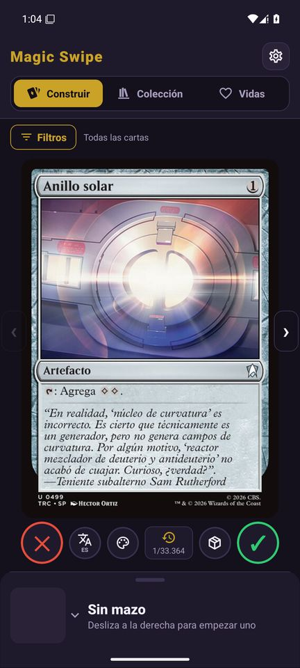 Construir: la carta en la mano</td></tr></table>

De arriba a abajo:

1. **Cabecera:** «Magic Swipe» y el botón ⚙ de [Ajustes](#7-ajustes).
2. **Pestañas:** **Construir** (cartas), **Colección** (estantería) y **Vidas** (corazón, el
   [contador de vidas](#11-contador-de-vidas)). La activa se ve en amarillo.
3. El contenido de la pestaña.

La app siempre se abre en **Construir**.

**¿Está en mi mazo?** Siempre que veas una carta en grande, una etiqueta te dice si está en el mazo que estás
construyendo: «En «Krenko Goblins»: 2» (dorada; también avisa si hay copias en el banquillo) o «No está en «Krenko
Goblins»» (gris).

**La tengo en cualquier carta:** donde veas una carta en grande (mazo, ficha ⓘ, combos, recomendadas, mano de prueba,
historial, listas de sinergias) está el botón **La tengo**. Cada toque añade una copia a tu colección; cuando ya tienes
alguna pasa a verde con «Tienes N ＋» y a su izquierda aparece **−** para quitar una. En las cartas del mazo, la línea de
la colección («En tu colección: 2», «Te falta 1», «No la tienes») tiene **−** y **＋** (o «＋ La tengo»), y en la vista
galería una cajita verde (las tienes todas) o amarilla (te faltan) en la esquina. Al quitar se quita primero esa
edición e idioma y, si no la tienes, la última copia que añadiste de esa carta.

**Código de colores** (igual en toda la app):

| Color | Significa | Ejemplos |
|---|---|---|
| Dorado | Crear, editar, la acción principal | Editar / Guardar el mazo, lápiz de cada carta, 👑 |
| Azul | Consultar información | ⓘ ficha, estadísticas, sinergias, fichas |
| Verde | Tu colección, lo que tienes, válido | La tengo, «Completo», ✓ válido |
| Amarillo | Te falta algo, revisar, comprar | «Faltan N», carrito de Cardmarket, avisos |
| Rojo | Quitar, vaciar, borrar, errores | Papelera, vaciar, ⚠ problemas |

Los botones de navegación, vistas y compartir van en blanco.

**¿Qué hace este botón?** Mantén el dedo sobre cualquier botón de icono (los del mazo y los de cada carta) y aparece
un globo con su nombre.

**Idioma de cualquier carta:** siempre que veas una carta en grande (en Construir, el historial, el mazo, la colección,
la ficha ⓘ, los combos, las recomendadas o la mano de prueba) tienes el botón **🌐 Idioma ▾** para verla en otro
idioma. En el **mazo** y la **colección** cambia la carta guardada (como ✏️ → Idioma); en las recomendadas, la carta se
añade en el idioma que elijas; en el resto solo cambia lo que ves.

## 3. Construir: las cartas en la mano

### Pasar cartas

| Gesto | Qué hace |
|---|---|
| Deslizar la carta a la **derecha** | La añade al mazo activo (si no tienes ninguno, crea «Mazo sin nombre») |
| Deslizar a la **izquierda** | La descarta |
| Deslizar hacia **arriba** | La aparta en **Posibles** del mazo |
| **Tocar** la carta | Abre su ficha: idioma, otras artes, Cardmarket, La tengo, La quiero, ± al mazo y a Posibles, texto, legalidad y Ficha completa (con ‹ › para pasar por los resultados) |

Para corregir una decisión, abre el **historial** y toca la carta: vuelves a ella.

### Los botones del lateral

A la derecha de la carta, a mano del pulgar. Están ocultos para dejar la carta entera: **desliza a la izquierda la
pestaña ‹** del lado derecho (o tócala) para sacarlos. Se esconden solos a los 4 segundos, al deslizarlos a la derecha
o al usar uno. La pestaña está un poco separada del borde para no activar el gesto «atrás» de Android.

- **♡ La quiero:** apunta esta versión (edición e idioma) para conseguirla; relleno si ya la quieres y con «Otra» si
  quieres otra versión.
- **📦 La tengo:** abre un panel con **−** y **＋** para quitar o añadir copias en tu [colección](#6-colección), y
  **Ver en mi colección**. Verde con un número si ya la tienes.
- **ⓘ Ficha:** la [ficha completa](#5-ficha-completa-de-una-carta) con todo lo de Scryfall.
- **Sinergias:** comandantes que más la usan, cartas con las que se juega y combos (EDHREC y Commander Spellbook); toca
  una para verla en grande.
- **Girar** (solo en cartas de dos caras): enseña la otra cara.
- **Idioma** (con el código del idioma actual): cambia la carta a otro idioma en el que exista.
- **Arte:** elige entre sus ilustraciones alternativas (primero las de tu idioma, luego las inglesas).

### La fila de datos

<table><tr><td align="center">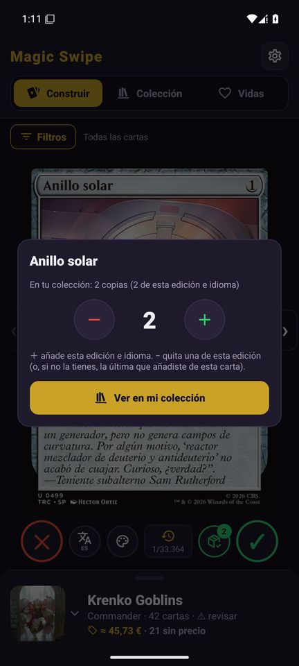 Panel de «La tengo»</td></tr></table>

Debajo de la carta, en una línea (se desliza si no cabe):

- **− ＋ 🃏 N** (mazo) y **− ＋ ? N** (Posibles), como en el PC: añade o quita copias de la carta en el mazo activo o en
  Posibles sin pasarla (se rellenan de color cuando ya la llevas).
- **⚠ No legal / Prohibida** en el formato del mazo activo.

### Los botones de abajo

De izquierda a derecha: **‹** carta anterior, **✕** descartar, el **contador** (`1/723`, abre el historial), **✓** añadir
al mazo (mantén pulsado para Posibles) y **›** pasar a la siguiente sin decidir.

### Historial ▤

<table><tr><td align="center">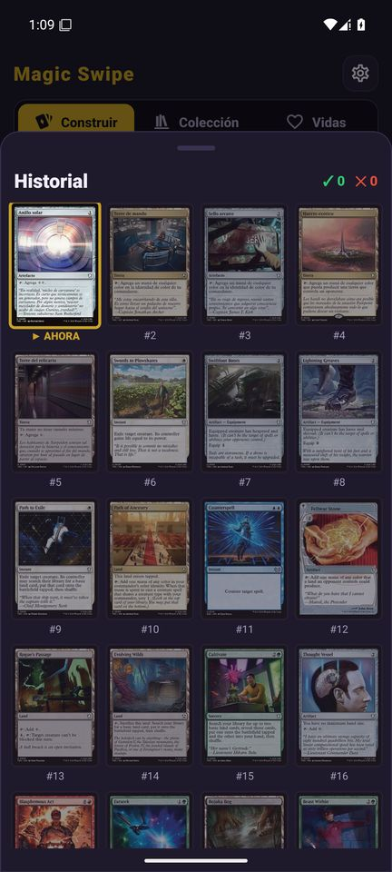 Historial</td></tr></table>

El botón del historial (con el contador) abre las miniaturas de las cartas vistas (con su decisión), la actual resaltada y las
siguientes. **Toca** una para saltar a ella; **mantén pulsado** para verla en grande. Al llegar al final carga más.

### Filtros

<table><tr><td align="center">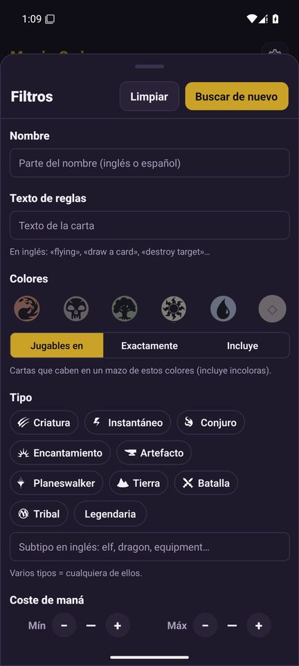 Filtros de búsqueda</td></tr></table>

La fila **Filtros** (debajo de las pestañas) muestra un resumen de lo que estás filtrando; tócala para cambiarlo:

- **Nombre** (en español o inglés, sin importar tildes) y **texto de reglas** (en español o inglés: cada palabra por
  separado y en cualquier orden; entre comillas, la frase exacta; lo escrito en español se traduce y debajo se ve qué se busca).
- **📦 Solo en mi colección:** las cartas salen solo de tu colección, con los mismos filtros, sin preguntar a Scryfall.
- **Colores**, con tres modos: *jugables en* (para un comandante), *exactamente* o *incluye*; e **incolora**.
- **Tipos** (varios a la vez), **legendaria**, **subtipo**, **coste de maná** mínimo y máximo.
- **Rareza**, **habilidades** (en español), **formato**, **edición** y **orden** de los resultados.
- **Solo cartas de MTG Arena:** muestra solo las cartas que existen en Arena (incluidas las de Alchemy, que no existen
  en papel). Los formatos de Arena (Historic, Timeless, Alchemy, Brawl, Standard Brawl) ya buscan cartas de Arena.

Pulsa **Buscar** para aplicar los filtros.

## 4. El mazo

### La barra del mazo

En la cabecera del mazo: **⚠ N** (en rojo, solo si hay problemas) abre la lista de problemas; un botón **abre o cierra
todos los grupos**; **ordenar** elige el orden de las cartas dentro de cada grupo (coste, nombre, orden de añadido —lo
más antiguo o lo último primero— o número de copias). Al bajar por las cartas, la portada, el nombre y los botones de acciones suben y la fila
de botones (⚠, abrir/cerrar, ordenar, agrupar, vistas) se queda fija arriba.

Arrastra la barra hacia arriba y el mazo sube siguiendo tu dedo: si lo sueltas pasada la mitad se abre, si no vuelve
abajo. También se abre tocándola. Los grupos y subgrupos que pliegues o abras se recuerdan, también al cerrar la app.

Abajo del todo está la barra del mazo activo: portada, nombre, formato, número de cartas, si es válido y su precio
aproximado. **Tócala o deslízala hacia arriba** para abrir el mazo. Con el mazo cerrado la portada es pequeña, para dejar
más sitio a las cartas; al abrirlo crece hasta su tamaño normal (y vuelve a encogerse al cerrarlo).

### Abrir, ampliar y cerrar

La hoja del mazo solo tiene dos posiciones: **abierta a pantalla completa** o **cerrada**. Para cerrarla, arrastra
hacia abajo (desde cualquier punto de la parte de arriba, incluidos los botones) o usa el botón atrás.

### La cabecera

<table><tr><td align="center">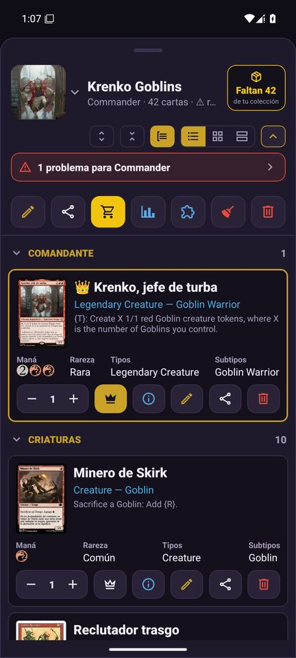 Mazo en vista lista</td><td align="center">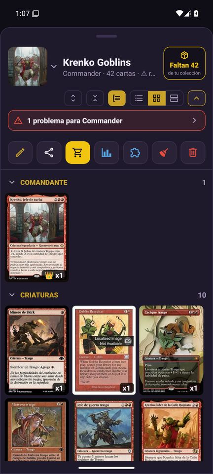 Vista galería</td><td align="center">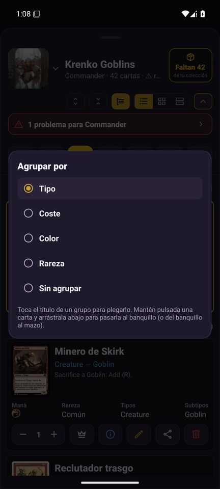 Agrupar por</td></tr></table>

- **Portada y flecha ⌄:** tócalas para desplegar **tus mazos**. Elige uno para cargarlo, **＋ Nuevo** para crear
  otro o **Importar** para pegar una lista ([ver más](#importar-una-lista)). El desplegable se cierra solo al elegir.
- **Nombre, formato, cartas y estado** (✓ válido / ⚠ revisar).
- **≈ precio** del mazo en Cardmarket.
- **Arriba a la derecha:** «Faltan N de tu colección» (amarillo; tócalo para ver cuáles y comprarlas) o «Completo»
  (verde): compara el mazo con tu colección.
- **Etiquetas del mazo:** debajo del nombre, las etiquetas del mazo y un botón 🏷 para ponerle o quitarle (son las
  mismas que las de las cartas). En la barra del mazo cerrada y en tus mazos se ven solo sus iconos.
- **Vistas:** los iconos de la derecha cambian entre **lista**, **galería**, **grande** y **texto**. La vista **texto**
  es la lista como en la imagen para compartir: copias, nombre, ⚠ si tiene un problema, etiquetas, «✓» o «falta N» de
  tu colección, − / ＋ y coste; con comandante, su carta sale en grande arriba.
  En la galería las miniaturas no tienen botones: toca una carta para verla en grande con todos sus botones debajo.
- **Agrupar** (icono de lista agrupada, junto a las vistas): por **tipo** (lo habitual), **coste**, **color**, **rareza** o
  sin agrupar. Cada grupo tiene su título con el número de cartas; tócalo para plegarlo. El comandante va siempre
  primero en su propio grupo. Funciona en las tres vistas y se recuerda. Los botones de **abrir todos** y **cerrar
  todos** (flechas que se abren / cierran) pliegan o despliegan de una vez todos los grupos y el banquillo.
- **Arrastrar al banquillo:** mantén pulsada la **imagen** de una carta (en cualquier vista) hasta que se levante, arrástrala hacia abajo
  y suéltala sobre la zona «Suelta aquí para pasarla al banquillo». Igual desde el banquillo para pasarla al mazo. Si la
  sueltas en otro sitio no pasa nada.
- **⋯ / ⌃:** oculta o muestra la fila de botones del mazo, para ganar espacio.
- **Recuadro de validación:** «✓ Mazo válido» o «⚠ N problemas». Tócalo para ver la lista de problemas y las cartas
  afectadas (toca una carta para verla).

### Botones del mazo

<table><tr><td align="center">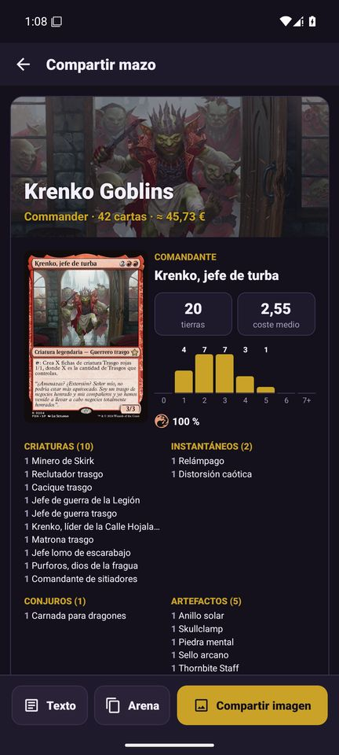 Compartir el mazo como imagen</td></tr></table>

| Botón | Qué hace |
|---|---|
| ✎ / 💾 | Editar el nombre y el formato (💾 si el mazo aún no tiene nombre) |
| Compartir | Crea una **imagen del mazo** para mandar por WhatsApp o redes: portada, comandante (o las 3 cartas más caras), tierras, coste medio, curva, colores y la lista por tipos. También se puede enviar **como texto** o copiar **para MTG Arena** ([ver más](#pasar-un-mazo-a-mtg-arena)) |
| Copiar (dos hojas) | **Duplicar el mazo**: crea «Nombre (copia)» con las mismas cartas, banquillo, Posibles, formato y portada, y lo abre |
| 🛒 (amarillo) | Comprar en Cardmarket las cartas que te faltan ([ver más](#8-precios-y-cardmarket)) |
| Gráfico de barras | [Estadísticas y mano de prueba](#10-estadísticas-y-mano-de-prueba) |
| Pieza de puzle | [Sinergias y combos](#9-sinergias-y-combos) del mazo |
| Fichas | Las fichas y emblemas que crean las cartas del mazo, con su imagen |
| Escoba | Vaciar el mazo (pide confirmación) |
| Papelera | Borrar el mazo (pide confirmación) |

### Cada carta del mazo

En las vistas lista y grande, cada carta muestra sus datos (coste con símbolos, rareza, tipos, fuerza/resistencia o
lealtad, precio, cuántas tienes en tu colección y sus problemas de validación) y estos botones:

| Botón | Qué hace |
|---|---|
| **− N +** | Cambia el número de copias. Bajar a 0 la quita |
| 👑 | Elegir comandante (solo en formatos con comandante) |
| ⓘ | Abre la [ficha completa](#5-ficha-completa-de-una-carta) |
| Lápiz | **Editar**: *Arte* (otra ilustración o edición), *Idioma* (la carta en otro idioma) o *Usar como portada* del mazo. Al cambiar arte o idioma mantiene las copias y el comandante; si era la portada del mazo, la portada cambia con ella |
| Compartir | Enviar la **imagen** de la carta (y copiar su enlace de Scryfall para pegarlo al lado), enviar solo el **enlace de Scryfall** o copiarlo |
| Bandeja ↓ | Pasar una copia al **banquillo** (no aparece en formatos con comandante) |
| Papelera | Quitarla del mazo (pide confirmación) |

### Banquillo

Al final de la lista de cartas del mazo (baja del todo) está el **Banquillo** (se pliega tocando su título). En los
mazos con comandante solo aparece si tiene cartas. Son las
cartas que llevas aparte: el sideboard de los formatos construidos (hasta 15) o el resto de tu pool en un draft.

- No cuenta para el tamaño del mazo, la curva, las estadísticas ni la mano de prueba.
- En cada carta: **− N +** para las copias y **bandeja ↑** para pasar una copia al mazo. Desde el mazo, la **bandeja ↓**
  la pasa al banquillo.
- En los formatos construidos el máximo de 4 copias cuenta también las del banquillo.
- Al compartir como texto o copiar para Arena se incluye el banquillo.

### Posibles

Debajo del banquillo está **Posibles**: un sitio para dejar cartas que te estás pensando o quieres probar, sin que
formen parte del mazo.

- **No cuenta para nada:** ni tamaño, ni validación, ni curva, ni estadísticas, ni mano de prueba, ni precio, ni
  «Faltan N», ni al compartir o exportar.
- Para mandar una carta: el botón **?** de cada carta del mazo, el de cada carta del banquillo, o **mantén pulsado ✓**
  al pasar cartas en Construir (la carta va a Posibles en vez de al mazo).
- En cada carta de Posibles: **− N +** para las copias y **bandeja ↑** para pasarla al mazo (o ↓ al banquillo).

### Deshacer

Al quitar una carta, vaciar o borrar el mazo aparece abajo una barra con **↶ Deshacer** durante 6 segundos. Deshacer
lo devuelve todo tal cual estaba (cantidades, comandante, portada…).

### Reglas que se comprueban

Puedes añadir lo que quieras: el mazo nunca te lo impide, solo te avisa.

| Formato | Comprobaciones |
|---|---|
| Commander, Duel, PreDH, Pauper Commander | Comandante elegido y elegible (dos con *Partner*, *Friends forever* o *Background*), 100 cartas exactas, 1 copia de cada carta, identidad de color y legalidad |
| Oathbreaker | Igual, con un planeswalker como líder y 60 cartas |
| Brawl (Arena) | Como Commander, con 100 cartas; el comandante puede ser una criatura o un planeswalker legendario |
| Standard Brawl (Arena) | Igual que Brawl, con 60 cartas |
| Historic, Timeless, Alchemy (Arena) | Como Estándar: mínimo 60 cartas, máximo 4 copias y legalidad |
| Estándar, Pioneer, Modern, Legacy, Vintage, Pauper, Premodern, Penny | Mínimo 60 cartas, máximo 4 copias contando el banquillo (1 si está restringida en Vintage), banquillo de hasta 15 y legalidad |
| Limitado (draft / sellado) | Mínimo 40 cartas. Sin límite de copias ni de legalidad: juegas lo que abriste. «Recomendar maná» apunta a unas 17 tierras |
| Libre | Sin comprobaciones |

Las tierras básicas y las cartas que permiten cualquier número de copias respetan su propia regla. En los formatos de
Arena, una carta que no existe en Arena sale como «No es legal».

### Pasar un mazo a MTG Arena

Arena no deja que otras apps lean ni cambien sus datos, así que se hace copiando y pegando:

1. En el mazo, pulsa **Compartir** y luego **Arena**. La lista se copia en el formato que entiende Arena (nombres en
   inglés y, si el mazo tiene comandante, su sección *Commander*).
2. En MTG Arena (móvil o PC): **Mazos → Importar**. Las cartas que no tengas se pueden crear con comodines.

Las cartas que no existen en Arena se quedan fuera de la lista (si no, Arena rechazaría todo el mazo) y la app te dice
cuáles son.

### Importar una lista

<table><tr><td align="center">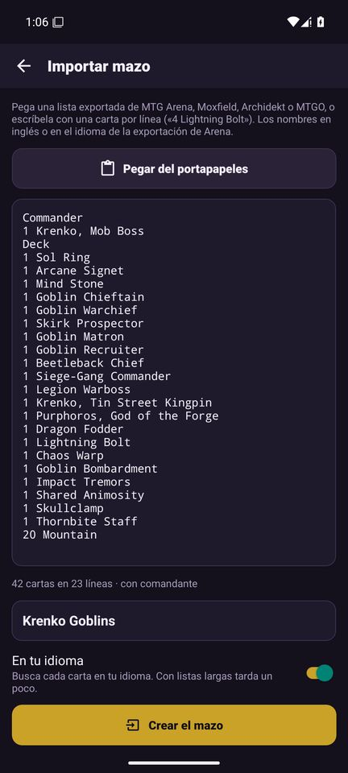 Importar una lista</td></tr></table>

Para traer un mazo de MTG Arena, Moxfield, Archidekt, MTGO o cualquier lista con una carta por línea («4 Lightning
Bolt», «1x Sol Ring (CMR) 472»):

1. Copia la lista (en Arena: en el mazo, *Exportar*).
2. Despliega tus mazos (portada ⌄) y pulsa **Importar**. En la colección, el botón de importar está junto a 📷.
3. **Pegar del portapapeles**, revisa el resumen (cartas, comandante, banquillo) y pulsa **Crear el mazo** o **Añadir a
   la colección**.

- Se respeta la edición cuando la lista la indica; si no, se usa la habitual de Scryfall.
- Vale también la exportación de Arena **en español** (cabeceras «Mazo», «Banquillo» y nombres en español): la carta
  se busca por su edición y número o por su nombre impreso.
- Con **En tu idioma** activado se busca cada carta en tu idioma (tarda un poco con listas largas).
- Si la lista tiene sección *Commander* (o la etiqueta de comandante de Archidekt), el mazo se crea en formato
  Commander con su comandante 👑. Si tiene unas 40 cartas (un **draft o sellado**, por ejemplo de Arena), en formato
  **Limitado**. Si no, en formato Libre: cámbialo con ✏️.
- El **banquillo** (*Sideboard* / *Banquillo*) va al [banquillo del mazo](#banquillo); en un draft de Arena es el
  resto de tu pool. Al importar a la **colección** el banquillo no se importa. Lo de *Maybeboard* nunca se importa.
- Al terminar verás las cartas que no se encontraron.

### Pasar de carta en la ficha

Al abrir una carta desde el mazo, la colección o Construir, **desliza a la izquierda o a la derecha** para ir a la
siguiente o la anterior de la lista: la otra carta entra siguiendo tu dedo, con su imagen y todos sus datos. El nombre, el coste de maná y el texto de reglas ya salen en la propia imagen de la carta, así que no se repiten debajo. Si sueltas
pasado un tercio de la pantalla (o con un golpe rápido) cambia; si no, vuelve. También con ‹ › de la cabecera.

## 5. Ficha completa de una carta

<table><tr><td align="center">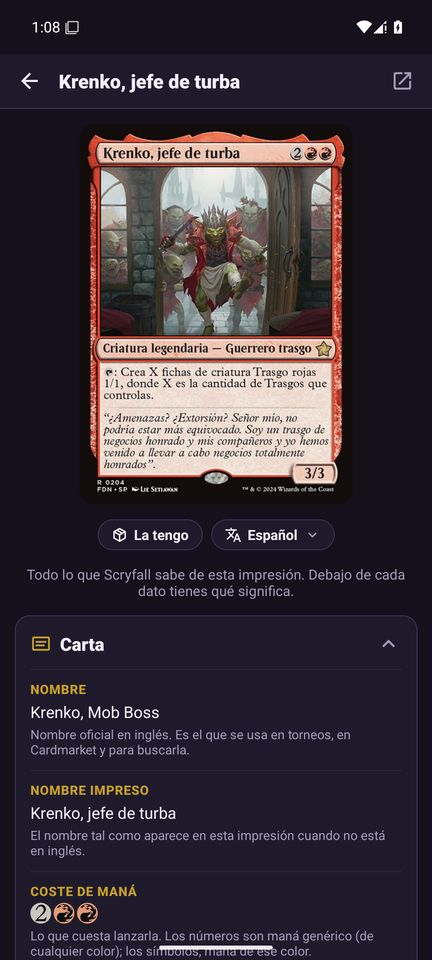 Ficha completa (ⓘ)</td></tr></table>

El botón **ⓘ** (en el mazo y en la colección) abre una pantalla con **todo lo que Scryfall sabe de esa impresión**.
Debajo de cada dato hay una explicación de qué significa.
Cada bloque se **pliega y despliega** tocando su título (flecha a la derecha), para ir directo a lo que buscas.

- **Carta:** nombre, coste, tipo, texto Oracle (el oficial y actualizado) y texto impreso, fuerza/resistencia,
  colores, identidad de color, palabras clave…
- **Caras:** en cartas de dos caras, partidas o con aventura.
- **Legalidad por formato:** verde legal, rojo prohibida, amarillo restringida.
- **Precios:** Cardmarket, TCGplayer y Magic Online.
- **Popularidad y estatus:** ranking de EDHREC, *Game Changer*, Lista Reservada…
- **Esta impresión:** edición, número, rareza, fecha, ilustrador, acabados, marco…
- **Cartas relacionadas, aclaraciones oficiales** (rulings, en inglés), **identificadores** y **enlaces**.
- **Sinergias:** cómo se usa en Commander, sus cartas afines si puede ser comandante y sus combos
  ([ver más](#9-sinergias-y-combos)).

Usa **←** para volver y **↗** para abrirla en Scryfall.

## 6. Colección

Arriba: el nombre (toca para ver un mazo dentro de la colección) con el total de cartas y su valor; la búsqueda con
**importar** y la **cámara**; y una fila con **Filtros** (con el número de filtros activos), **♡ La quiero** (solo las que
quieres), **seleccionar**, **abrir o cerrar todos los grupos** (al agrupar), **agrupar** (agrupación y subgrupo en un
menú) y las mismas **vistas que el mazo**: lista, galería, grande (la carta a todo el ancho con sus botones) y texto (una
línea por carta con − ＋). La vista elegida se recuerda. Al bajar por la lista, el título y el buscador suben y la fila de botones se queda fija arriba, con el
nombre en pequeño (tócalo para cambiar de mazo). **Desliza la lista a la izquierda o a la derecha** para cambiar de
vista (también en el mazo): la vista nueva entra siguiendo tu dedo, con sus cartas (la cabecera se queda fija;
solo se deslizan las cartas); sueltas pasado un tercio para cambiar. Si tienes etiquetas, debajo salen para filtrar
(la última abre su gestión).

<table><tr><td align="center">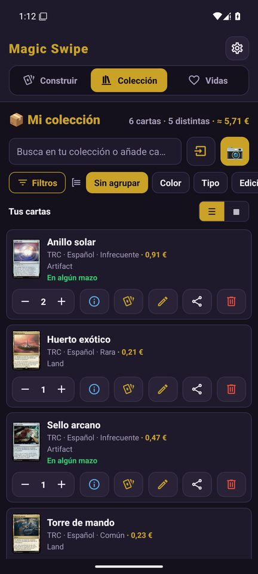 Tu colección</td></tr></table>

Aquí apuntas las cartas que tienes. Cada fila es una **impresión** concreta (edición + idioma).

### La quiero

Al lado de **La tengo**, en cualquier carta en grande (y en las cartas del mazo que te faltan), está **♡ La quiero**:
márcala y queda apuntada como carta que quieres conseguir.

- Las cartas que quieres salen **en tu colección**, mezcladas con las tuyas y con un **♥**. Si aún no la tienes, sale
  con 0 copias y el botón **＋ La tengo** para pasarla a tu colección cuando la consigas (y se quita de «La quiero»).
- El botón **♡ Las quiero (N)** de la colección muestra solo esas.
- Vuelve a tocar el corazón para quitarla.

### Añadir cartas

- **Buscando:** escribe en el buscador. Verás tus cartas que coinciden y, debajo, resultados de Scryfall para añadir
  con **＋** (en el idioma de los ajustes si existe).
- **📷 Escáner:** apunta la cámara a una carta y la reconoce (por el nombre y por la edición y el número de abajo).
  Confirma con «＋ Añadir a la colección» o pulsa «↻ No es esta». Si no la reconoce, puedes buscarla a mano. *No funciona
  en Expo Go, solo en la app instalada.*
- **Desde Construir:** botón **📦 La tengo** encima de la carta.
- **Importar una lista** (botón junto a 📷): pega una lista de cartas, por ejemplo la exportación de otra web, y se
  suman todas a la colección con su edición si la lista la indica ([ver más](#importar-una-lista)).

Arriba se muestra el total de cartas, las distintas y el **valor aproximado** de la colección.

### Filtros

El botón **Filtros** abre un panel que se aplica al momento (arriba dice cuántas cartas quedan; **Limpiar** los quita):
color, tipo, coste, rareza, edición, idioma, precio por copia, **uso en mazos** (todas / en algún mazo / libres) y
**solo repetidas** (2 copias o más, útil para cambiar).

### Agrupar

Los botones junto a Filtros agrupan la lista en secciones plegables (toca la cabecera para plegar), cada una con sus
copias y su valor: **Color**, **Tipo**, **Edición** (de la más nueva a la más antigua), **Rareza**, **Coste** y
**Precio** (por tramos).

### Cada carta

| Botón | Qué hace |
|---|---|
| **− N +** | Copias que tienes. Bajar a 0 la quita (se puede deshacer) |
| ⓘ | [Ficha completa](#5-ficha-completa-de-una-carta) |
| Cartas | Añadirla al mazo activo |
| Lápiz | **Cambiar el arte o el idioma**: pasa tus copias a otra impresión de la carta, con otra ilustración o en otro idioma (si ya tenías esa, se suman) |
| Compartir | Enviar la **imagen** de la carta (y copiar su enlace de Scryfall para pegarlo al lado), enviar solo el **enlace de Scryfall** o copiarlo |
| Papelera | Quitarla de la colección (pide confirmación y se puede deshacer) |

Si la carta está en algún mazo verás «En algún mazo» en verde. La vista **galería** (▦) muestra solo las imágenes.

## 7. Ajustes

<table><tr><td align="center">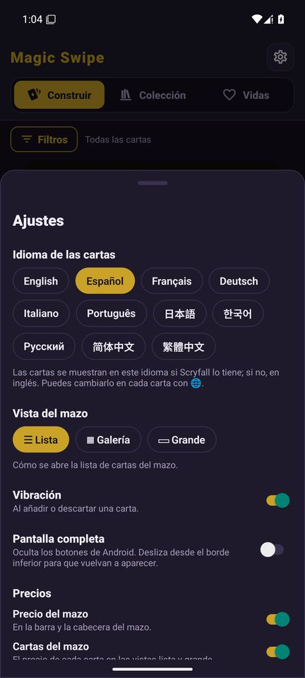 Ajustes</td></tr></table>

Botón ⚙ de la cabecera:

- **Idioma de las cartas:** las cartas se muestran en ese idioma cuando existen.
- **Cartas y listas → Elegir datos e iconos** (como en el PC), para el mazo y la colección:
  - **Lista:** qué datos salen en cada línea de la fila de cada carta (coste, tipo, tipos, subtipos, texto, F/R, edición,
    idioma, rareza, precio, legalidad, etiquetas, en tu colección, en tus mazos, La quiero…). Toca un dato para moverlo
    (antes, después, subir o bajar de línea) o quitarlo; **＋** añade otro a esa línea. De 1 a 5 líneas, con vista previa.
  - **Galería:** dónde va cada icono sobre la carta (copias, en tu colección, La quiero, Posibles, problemas, en algún mazo,
    precio, rareza, edición, idioma, etiquetas). Toca una casilla de la cuadrícula de 3 × 4 y marca los iconos de esa casilla.
  - **Restablecer** vuelve a lo de siempre.
- **Vista del mazo por defecto:** lista, galería, grande o texto.
- **Etiquetas:** muestra u oculta las etiquetas de las cartas y los mazos en las listas (se pueden seguir poniendo).
- **Vibración** al añadir y descartar.
- **Pantalla completa:** oculta los botones de Android (desliza desde abajo para verlos).
- **Mano (beta):** muestra la pestaña «Mano» (ver [Mano (beta)](#12-mano-beta)); avisa de que está en pruebas.
- **Precios:** un interruptor para cada sitio donde salen precios, por si prefieres no verlos:
  - **Precio del mazo** (barra y cabecera del mazo).
  - **Cartas del mazo** (el precio de cada carta).
  - **Lo que te falta (🛒)** (total y precio de cada carta al comprar).
  - **Colección** (valor total, de cada grupo y de cada carta, y el filtro y la agrupación por precio).
  - **Ficha completa** (la sección «Precios»).
- **Sincronizar con el PC:** ver abajo.
- **Restablecer filtros.**

### Sincronizar con el PC

Si también usas **Magic Swipe para PC**, puedes tener en los dos los mismos mazos, colección, «La quiero» y etiquetas:

1. En el PC pulsa **⇄ Móvil** (arriba a la derecha). Aparece un código QR.
2. En el móvil, **⚙ Ajustes → Sincronizar con el PC → Sincronizar** y **Escanear el código del PC**. Los dos tienen que
   estar en la **misma Wi-Fi**.
3. En la pantalla del PC aparece **todo lo que es distinto**: mazos (y qué cartas cambian), colección, «La quiero» y
   etiquetas, cada cosa con la **opción sugerida ★** ya marcada (el cambio más reciente). Cambia lo que quieras: quedarte
   con la del PC o la del móvil, pasar o borrar lo que solo está en uno, y en los mazos cambiados en los dos, **Juntar
   ambas**.
4. Pulsa **Aplicar** en el PC. El móvil guarda su parte solo y los dos quedan iguales. Hasta entonces no cambia nada.

Antes de aplicar, cada aparato guarda una **copia** de sus datos. Abajo, en **Copias de antes de sincronizar**, puedes
**Restaurar** cualquiera de las tres últimas (solo cambia ese aparato).

**Copiar o mover** (avanzado) pasa todo de un aparato al otro sin revisar: el destino recibe todo lo del origen, lo que
coincide se sustituye y, con **Mover**, se borra del origen.

La próxima vez basta con **Otra vez con el mismo PC** (con la ventana del PC abierta). Si no puedes escanear, escribe la
dirección y el código que enseña el PC. Los ajustes y el contador de vidas no se pasan.

## 8. Precios y Cardmarket

- Los precios son el **precio de tendencia de Cardmarket** que publica Scryfall, actualizado **una vez al día**. Son
  orientativos.
- Scryfall casi nunca da precio a las cartas en español: en ese caso se usa el de la versión inglesa de la misma edición.
- Sin conexión los precios no aparecen.
- Puedes ocultarlos en cada sección desde [Ajustes → Precios](#7-ajustes).
- **Comprar lo que te falta:** en el mazo, botón 🛒. Verás las cartas que no tienes en tu colección con su precio y el
  total. Toca una para abrir su página en Cardmarket, o **📋 Copiar lista** y pégala en Cardmarket → *Listas de
  deseos* → *Añadir lista de mazo* para comprarlas todas de una vez.

## 9. Sinergias y combos

Scryfall no sabe qué cartas funcionan bien juntas, así que la app lo consulta en dos webs de la comunidad:

- **[EDHREC](https://edhrec.com):** analiza cientos de miles de mazos de Commander publicados en internet.
- **[Commander Spellbook](https://commanderspellbook.com):** la base de datos de combos conocidos.

### En la ficha de una carta (ⓘ)

- **Uso en Commander:** en cuántos mazos se juega y qué porcentaje de los que podrían llevarla (los de sus colores),
  su «sal» (cuánto molesta a los rivales, de 0 a 4), los comandantes que más la usan y las cartas que más la acompañan.
- **Como comandante** (solo criaturas legendarias y cartas que pueden serlo): cuántos mazos la llevan de comandante y
  sus cartas de **más sinergia**. La sinergia es cuánto más aparece una carta en los mazos de ese comandante que en la
  media de mazos de sus colores: +30 % significa que es una elección muy propia de ese comandante.
- **Combos:** los 10 combos más jugados en los que participa. Cada uno muestra sus cartas, qué consigue (maná
  infinito, ganar la partida…), el maná para empezar y en cuántos mazos se juega. «Cómo funciona» despliega los
  requisitos y los pasos (en inglés); el enlace lleva a Commander Spellbook. Toca una carta del combo para verla en
  grande.

Toca cualquier carta de estas listas (comandantes, cartas que la acompañan, cartas de más sinergia) para verla en
**grande**: puedes cambiar su idioma, marcar **La tengo** para tu colección o **Añadir al mazo** activo.

### En el mazo (botón de la pieza de puzle)

<table><tr><td align="center">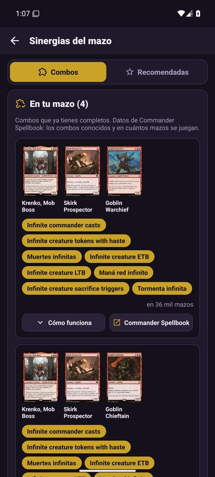 Combos del mazo</td><td align="center">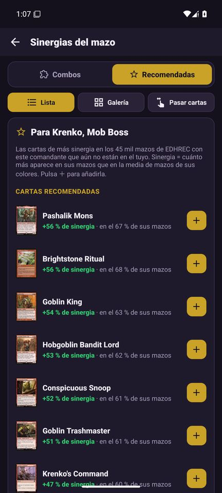 Recomendadas</td></tr></table>

Se abre una pantalla con dos pestañas:

- **Combos:** los que el mazo ya tiene completos y los que están **a una carta** (la que falta, marcada en amarillo).
  Funciona con cualquier formato. Toca una carta para verla en grande; la que falta tiene un **＋** (en su miniatura
  y en la vista grande) que la añade al mazo, en tu idioma si existe, y pasa a «Añadida».
- **Recomendadas:** las cartas de más sinergia para el **comandante** del mazo que aún no tienes, con **＋** para
  añadirlas (en tu idioma si existe). Necesita un formato con comandante y haberlo elegido con 👑. Con dos comandantes
  se usa el primero.
  - Tres vistas con los botones de arriba: **Lista** (con su sinergia y uso), **Galería** (imágenes en 3 columnas) y
    **Pasar cartas**: las recomendadas te llegan a la mano una a una, como en Construir. Derecha (o ✓) la añade al
    mazo, izquierda (o ✕) la descarta. Llega hasta las 100 de más sinergia y cuenta cuántas llevas añadidas.

Estas webs no son oficiales: si cambian, alguna sección puede dejar de cargar hasta que se actualice la app.

## 10. Estadísticas y mano de prueba

El botón del **gráfico de barras** del mazo abre una pantalla con dos pestañas.

### Estadísticas

<table><tr><td align="center">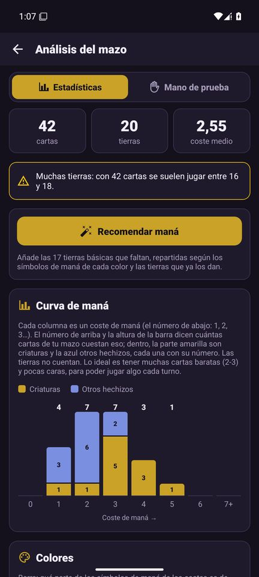 Estadísticas</td><td align="center">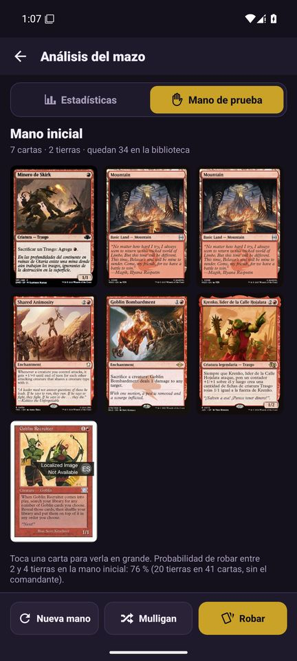 Mano de prueba</td></tr></table>

- **Cartas, tierras y coste medio** (el coste medio no cuenta las tierras), y un aviso si tienes **pocas o muchas
  tierras** para el tamaño del mazo: con 100 cartas se suelen jugar 35-38; con 60, unas 22-26. Es orientativo: un mazo
  de costes muy bajos puede ir con menos.
- **Recomendar maná** (como en Arena): añade las **tierras básicas** que faltan para llegar a lo recomendado, en tu
  idioma. Las reparte según los símbolos de maná de cada color y las tierras que ya los dan, así que van primero a los
  colores que andan cortos. Antes de añadirlas te enseña cuántas de cada tipo; después puedes **deshacer**. En
  Commander solo usa los colores del comandante; si con las tierras el mazo pasa de 100 cartas, te avisa y el
  aviso de reglas del mazo te lo recordará hasta que quites hechizos.
- **Curva de maná:** cuántas cartas hay de cada coste, separando criaturas (amarillo) y otros hechizos (azul), cada parte con su número. La última columna junta
  las de coste 7 o más. Las cartas partidas y las Habitaciones (dos costes, como «Tienda de muñecas // Galería de
  porcelana») cuentan por su mitad más barata, que es lo que puedes lanzar antes.
- **Colores:** qué parte de los símbolos de maná de los costes es de cada color, y cuántas tierras pueden dar ese color.
  Si un color tiene muchos símbolos y pocas tierras, te costará lanzar esas cartas.
- **Tipos:** cuántas criaturas, tierras, instantáneos, etc. lleva el mazo.

### Mano de prueba

Baraja el mazo y roba 7 cartas, como al empezar una partida (sin el comandante, que empieza fuera).

- **Nueva mano:** vuelve a barajar y roba 7.
- **Mulligan:** baraja y roba 7 otra vez; después toca tantas cartas como mulligans lleves para ponerlas **al fondo**
  (regla actual del mulligan). Puedes cambiar de idea tocándolas de nuevo antes de robar.
- **Robar:** roba la siguiente carta, para ver cómo sigue la partida turno a turno.
- Toca una carta para verla en grande. Debajo verás la probabilidad de que la mano inicial traiga entre 2 y 4 tierras.

## 11. Contador de vidas

<table><tr><td align="center">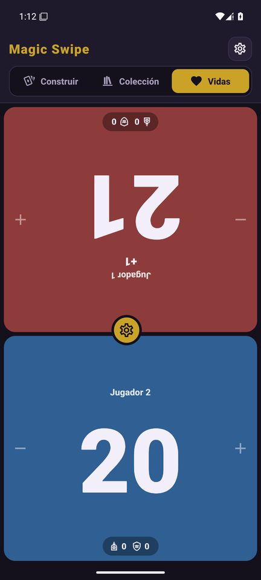 Contador de vidas</td></tr></table>

La pestaña **Vidas** es un contador para partidas de 2 a 6 jugadores. Deja el móvil en el centro de la mesa: los
jugadores de la fila de arriba ven sus números del derecho desde el otro lado. Mientras estás en esta pestaña la
pantalla no se apaga.

- **Vidas:** toca la mitad **izquierda** de tu recuadro para restar 1 y la **derecha** para sumar 1. Mantén pulsado
  para restar o sumar 10. Encima del número aparece el cambio acumulado (por ejemplo «−5») durante un momento.
- **Quién hace el daño:** con 3 o más jugadores, el lado **−** se parte en un botón por rival, con su color y su nombre
  (y «Otro» para lo demás): toca el del jugador que te hace el daño. Con 2 jugadores se sobreentiende que es el otro.
  El lado **＋** es un solo botón.
- **Turnos y fases** (menú ⚙ → Pantalla → Turnos y fases): entre las dos filas sale una barra con de quién es el
  turno (en su color), el turno, la ronda y su tiempo, y la fase o el paso en que estáis (Inicio: enderezar,
  mantenimiento, robar · Principal 1 · Combate: inicio, atacantes, bloqueos, daño, final · Principal 2 · Final: paso
  final, limpieza), con un punto por cada uno. **▶** (o tocar la fase) avanza; tras la limpieza pasa al siguiente
  jugador. **⏭** pasa el turno; mantenlo pulsado para quitar los turnos. El ⚙ del menú pasa a esa barra y el recuadro
  del jugador del turno se marca en blanco. Las estadísticas suman los turnos de cada uno y su duración media.
- **Estadísticas de la partida:** cuando solo queda un jugador sale «Fin de la partida»: el ganador, cuánto ha durado,
  el daño total, premios (más daño hecho, golpe más fuerte, el más castigado, más vida ganada, daño de comandante),
  los números de cada jugador (vidas, daño hecho y recibido, comandante, vida ganada, mínimo, golpe mayor, veneno,
  cuándo y por quién fue eliminado) y quién hizo daño a quién. También están en el menú ⚙, en cualquier momento.
- **Daño de comandante:** abajo de cada recuadro hay una píldora por cada rival, con su color: **−** y **＋** cambian el
  daño de comandante que has recibido de él. También resta vidas, y la píldora se marca en rojo al llegar a 21.
  Con 4 o más jugadores, cada rival es un círculo con su color y el daño: **toca** para sumar 1 y **mantén pulsado** para restar.
- **Veneno y ajustes del jugador:** el botón de debajo muestra tu veneno; al tocarlo puedes cambiar tu nombre y color,
  el **veneno**, el daño de comandante y tus **fotos**.
- **Fotos** (con el efecto «Fotos» activado): en los ajustes de cada jugador hay tres: **Recibe daño**, **Hace daño** y **Sube vida**. Toca un círculo,
  pulsa **Hacer foto** (cuenta atrás de 3 segundos con la cámara delantera) y **Guardar**. La foto aparece un momento en
  tu recuadro cuando pierdes vidas o recibes veneno o daño de comandante (con una sacudida), cuando haces daño de
  comandante a otro jugador y cuando ganas vidas. Se ve dentro de un círculo: centra la cara. Se conservan al empezar
  otra partida.
- **Eliminado:** el recuadro marca ☠ cuando un jugador se queda sin vidas, llega a 10 de veneno o recibe 21 de daño
  del mismo comandante.
- **Menú (⚙ amarillo del centro):**
  - **Nueva partida:** elige el número de jugadores y las vidas iniciales (20, 25, 30 o 40; Commander usa 40). Se
    mantienen los nombres y colores.
  - **¿Quién empieza?:** sortea un jugador y le pone una 👑.
  - **Dado de 6, dado de 20 y moneda.**
  - **Pantalla:** muestra u oculta el nombre, el cambio acumulado, las marcas − / ＋, los botones de quién hace el
    daño, el daño de comandante y el veneno.
  - **Efectos:** Fotos, Destellos (rojo al perder vidas, verde al ganarlas), Temblor, Números al vuelo, Latido (con
    5 vidas o menos), Calavera al quedar eliminado y Confeti para el ganador.

La partida se guarda sola: si cambias de pestaña o cierras la app, sigue donde la dejaste.

## 12. Mano (beta)

Pestaña en pruebas: con el móvil en un soporte apuntando a tu mano, la cámara lee los títulos de las cartas y apunta lo
que robas y lo que juegas.

- **Activarla:** Ajustes → **Mano (beta)**. Avisa de que está en pruebas y puede equivocarse; viene apagada y se puede
  desactivar cuando quieras (la pestaña desaparece).
- **Guía:** la primera vez explica, con dibujos, cómo colocar el móvil (en un soporte, a unos 30–40 cm, mirando desde
  arriba) y cómo abrir la mano en abanico (que se vean los títulos). Se vuelve a ver con **?** sobre la cámara.
- **Necesita un mazo activo:** solo reconoce las cartas de ese mazo (el comandante no cuenta).
- **Empezar / Pausar** lee una foto cada medio segundo; **En la mano** lista lo que ve y **Lo que ha pasado**, cada
  carta robada o que sale. Toca una carta para corregirla; **Reiniciar** vacía la mano; **Ver texto** muestra lo que lee.
- **Consejos:** buena luz y sin reflejos, cartas del derecho y títulos sin tapar.

## 13. Preguntas frecuentes

**¿Dónde se guardan mis mazos?** En el móvil. Si desinstalas la app, se pierden.

**He borrado algo sin querer.** Si fue hace menos de 6 segundos, pulsa **↶ Deshacer** en la barra de abajo.

**El escáner dice que no está disponible.** Estás usando Expo Go; el escáner solo funciona en la app instalada (APK).

**Una carta sale sin precio.** Scryfall no tiene precio de esa impresión ni de su versión inglesa (pasa con algunas
promos y ediciones especiales).

<!-- Pendiente de documentar cuando existan: contador de vidas y nuevas herramientas. -->
